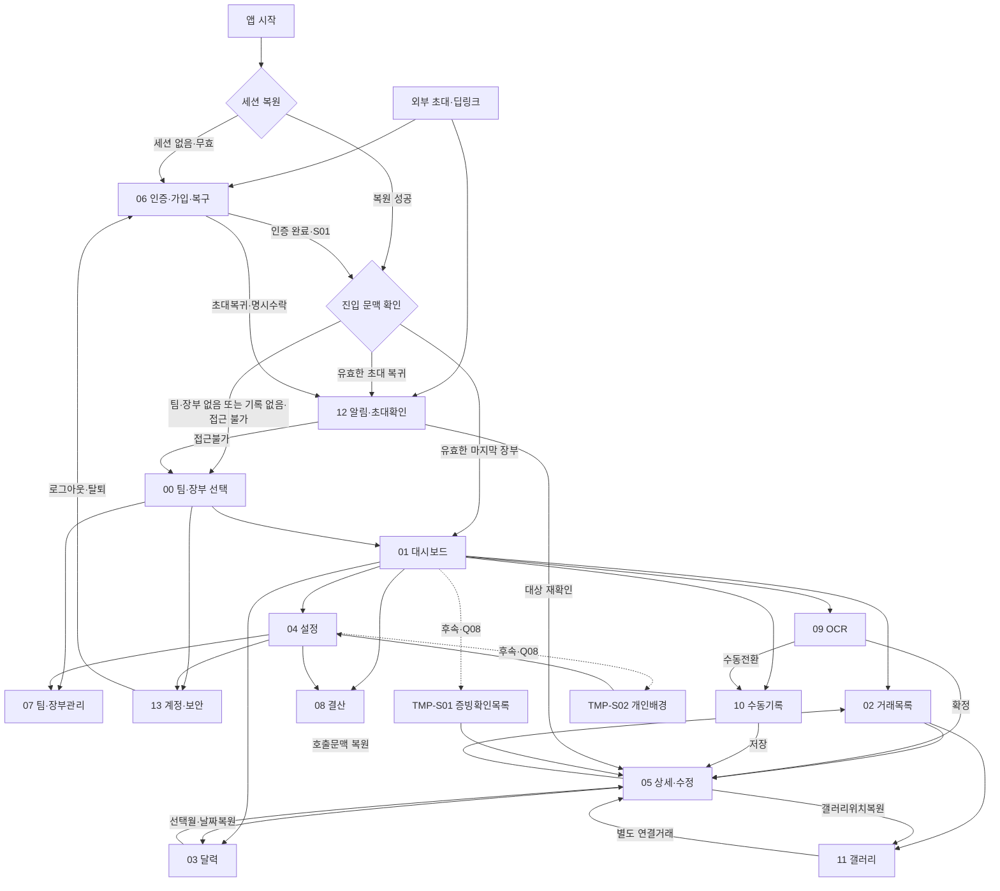

# 공금이 화면설계서

작성일 2026-11-06 · 개정 2026-11-10 · 앱 시작 동작 START-01/02 반영

## 기준과 표기

원문 화면은 00~13의 14개다. 각 버튼 TMP-UI/TMP-COMMON과 라우트·하위폼은 설계 제안이다. 원문 기능·권한은 기능명세,전송계약은 API명세,제약은구현계획·검토보고서를 따른다. 최신작성일만으로 계약을 덮어쓰지 않는다. 근거파일·버전·행번호·추출목록은 설계_검증보고서의 고정 기준목록을 참조한다.

모든 14개 화면의 목적·레이아웃과 버튼 상세는 아래에 있다. 공통 C규칙은 각 화면이 명시적으로 상속하는 설계다. 입력·API 계약은 화면별_API_연결표의 LINK 및 요청스키마표와 연결한다.

## 화면 간 이동

공통 인증·재인증·영향확인·내보내기·삭제진행은 독립 확정 화면을 늘리지 않고 해당화면의 하위상태로 제안한다. 05는 02뿐 아니라 03/11/12 등 실제 호출문맥으로 복귀한다. 로그인되지 않은딥링크는 안전한대상문맥만 유지하고 06→권한재확인 후대상 또는 00으로 간다. 토큰은 URL에서제거하고 I05본문으로 전달한다.

## 앱 시작 · 로그인 유지와 마지막 장부 복귀

- START-01. 앱을 다시 열면 로그인 화면을 띄우기 전에 세션을 복원한다. 복원 확인 중, 무효 세션, 네트워크 오류를 구분한다. 로그아웃 또는 비밀번호 재설정 완료 후에는 06으로 이동한다. 세션 수명 변경은 BE-03 계약을 따른다.
- START-02. 일반 진입에서 현재 계정의 마지막 팀·장부를 확인한다. P05로 접근을 확인한 장부는 01로 바로 이동한다. 팀·참여 장부가 없거나 첫 선택 기록이 없거나 기록의 접근 권한을 잃었으면 00으로 간다. 팀·장부 전환은 00에서 제공한다.
- 유효한 초대 복귀와 명시적 딥링크는 마지막 장부보다 먼저 처리한다. 접근 확인에 실패하면 안전한 목록이나 오류 상태로 이동한다.

상태별 처리와 시험은 [앱 시작 동작 결정 기록](앱_시작_동작_결정기록.md)을 따른다.

## 공통 C규칙

| 규칙 | 구체 설계 |
| --- | --- |
| C01 로딩·빈 상태 | 첫조회 스켈레톤/상태텍스트,필수옵션 수신 전 저장제한. 목록은현재조건없음+권한있는생성만 표시. 상세 404는빈폼으로생성하지 않음. |
| C02 제출·입력 | submit중 같은작업 버튼 비활성·aria-busy,동일의도재시도는같은키. 업무내용변경시새키. 오류/네트워크실패에는입력유지,성공후폼초기화. 민감 OTP/비밀번호는일반캐시에저장하지않음. |
| C03 오류·인증 | API연결표 E오류사전 적용. 세션만료 A06 단일갱신,다중탭 Q03,실패시 06+안전한복귀문맥. 잠금/현재 2FA503/설정장애 자동루프없음. 종료미확정과완료구분. |
| C04 권한·상태 | 매요청서버권한. 팀직급과프로젝트역할분리. 권한상실시민감캐시/blob폐기. LOCKED는조회/허용출력/후임만,거래삭제·예산·항목·기간변경차단. DELETING은일반접근차단,허용 D01/D02만. |
| C05 영향·충돌 | CONFIRMATION_REQUIRED/STALE는사유별서버금액·token으로다시확인·같은키제출. BLOCK/확정중복우회없음. VERSION_CONFLICT는최신 GET+입력비교,자동덮어쓰기없음. |
| C06 취소·복귀 | 뒤로/취소/모달닫기는호출자·필터·스크롤·선택일복원. 미저장변경은유지/폐기대화상자(제안). 미연결파일은 F04,OCR은 O04후사용참조확인. 기존연결파일직접삭제금지. |
| C07 동기화 | 거래성공/삭제 후 H03/H02/P12/H06/P13/G01관련캐시재조회. 예산 B01/P05/P12/P13/B03,멤버 T05/P07/권한캐시,초대 I01/T01/P01/N01/N02,읽음 N01/N02 갱신. |
| C08 접근성·반응형 | 설계제안.320/390은단일열·필터줄바꿈·긴표는라벨있는가로영역,키보드도접근. 입력label/단위/오류연결,모달첫입력포커스·Tab순환·Esc·트리거복귀. 파괴작업기본포커스취소. 상태aria-live,오류요약에서필드이동. 터치영역 44px제안은기존 36px버튼시각규격과협의. 실제접근성시험미실행. |
| C09 시각·금액 | 회계일 Asia/Seoul,서버시각 UTC. 미입력시각을 00:00으로만들지않음. ID문자열·단건정수·합계문자열/BigInt. UNSET/null·0·양수구분. 기존명세의작은폰트를최종접근성인증으로간주하지않음. |

## 역할 기준

기능명세§0.1~0.5와 API§3.2를 적용한다. OWNER/ADMIN/MEMBER와 PROJECT_ADMIN/PROJECT_MEMBER는 별도축이다. 미참여 OWNER는 P14/P15의 ID·이름·상태만,일반회계조회불가. 본인지출도현재참여·잠금검사. 수입은총무만,결산조회는참여자,결산출력은총무,갤러리 ZIP은참여자다. 원문 역할 VIEWER는사용하지않는다.

## 화면 00 · 팀·장부 선택

| 항목 | 설계 |
| --- | --- |
| ID·목적 | 00 / 팀·장부 선택 — 팀 선택 → 참여장부 → 공개참여(최소정보) → 생성/관리 → 삭제현황의 업무 수행 |
| 관련 기능·우선순위 | F-AUTH-01(P0 (필수)), F-AUTH-05(P0 (필수)), F-PROJ-04(P1 (주요)), F-PROJ-06(P0 (필수)), F-PROJ-11(P1 (주요)), F-TEAM-01(P0 (필수)), F-TEAM-02(P1 (주요)), F-TEAM-03(P1 (주요)), F-TEAM-05(P0 (필수)), F-TEAM-06(P0 (필수)) |
| 인수 조건 | AC-02, AC-13, AC-14, AC-22, AC-24 |
| 진입·이전·복귀 | 인증 또는 복원 뒤 팀·장부 없음, 마지막 기록 없음·접근 불가, 전역 팀·장부 전환. 유효한 마지막 장부가 있으면 01로 바로 이동 |
| 라우트 | 설계 제안 — /teams |
| 권한·접근불가 | 각 버튼의 조건 및 API연결표 권한 적용. 조회도현재참여필수,공개인증은예외. 불가시 C03/C04 |
| 주요영역·표시출처 | 팀 선택 → 참여장부 → 공개참여(최소정보) → 생성/관리 → 삭제현황; 아래 진입 LINK의 응답필드→해당영역. 원문에없는활동시각/수정자추정없음. |
| 진입 조회 | LINK-0001, LINK-0002, LINK-0003, LINK-0004, LINK-0005, LINK-0006, LINK-0007, LINK-0008 |
| 입력 | 아래 LINK가 참조하는 요청스키마·Query표가 필드/자료형/필수/초기값의 기준. 로컬선택은 TMP버튼행. 서버값·역할·작성자임의입력금지. |
| 동작·성공·실패 | 아래 버튼표 + LINK별요청/표시/오류/동기화. C01~C09 상속 |
| 중복제출·입력유지 | C02/C05,민감입력은재인증종료시폐기. 동일성공키응답을다시차감하지않음 |
| 로딩·빈결과·재시도 | C01/C03,특수상태는아래 추가조건 |
| 상실·만료·잠금 | C03/C04,세션해제후보호데이터표시중단 |
| 성공 갱신·이동 | 버튼표의목적화면+LINK별캐시집합,C07 |
| 뒤로·취소·미저장 | C06,조회필터는로컬유지.쓰기없는조회는미저장경고해당없음 |
| 작은화면·키보드·포커스 | C08.05/09/10의모달닫기후호출버튼복귀,03은선택일복원,07의여러관리폼은한번에한구역. 실제시험미실행 |
| 근거 | API명세§13.2 L5591; API D01, API D02, API F05, API F06, API I05, API P01, API P03, API P04, API P05, API P12, API S01, API T01, API T03, API T05 |
| 미결정·제안 |  / 모든 TMP버튼·라우트·배치는설계제안 |

| 임시 버튼 ID | 버튼·링크·메뉴 | 사전조건 | API 호출 LINK | 성공결과 | 실패·후속 |
| --- | --- | --- | --- | --- | --- |
| TMP-UI00-01 | 팀 선택 | 활성 팀원 | LINK-0009, LINK-0010, LINK-0011, LINK-0012, LINK-0013 | 선택 팀과 참여/공개 목록 갱신 | 미참여 비공개 장부 노출 금지; C01~C09 |
| TMP-UI00-02 | 참여 장부 카드 | 활성 프로젝트 참여자 | LINK-0014, LINK-0015 | P05 확인 후 01로 이동하고 현재 계정의 마지막 팀·장부를 갱신 | 404 접근 불가, DELETING 상태 안내; C01~C09 |
| TMP-UI00-03 | 참여 가능한 장부 보기 | 활성 팀원 · P1 | LINK-0016 | 최소 공개 목록 표시 | 잔액·거래·참여자 상세 미노출; C01~C09 |
| TMP-UI00-04 | 공개 장부 참여 | 활성 팀원 · TEAM_ALL/ACTIVE | LINK-0017 | 참여 후 P01 갱신, 01로 이동 | LOCKED 거절, 기존 활성 참여는 중복 생성 없음; C01~C09 |
| TMP-UI00-05 | 팀 만들기 | 로그인 사용자 | 해당없음 — 로컬선택/이동,결과 칸 참조 | 07 팀 생성 폼 → 제출 T02 | 취소 시 생성 없음; C01~C09 |
| TMP-UI00-06 | 장부 만들기 | 선택 팀 OWNER/ADMIN | 해당없음 — 로컬선택/이동,결과 칸 참조 | 07 장부 생성 폼 → 제출 P02 | 팀 MEMBER는 생성 권한 없음; C01~C09 |
| TMP-UI00-07 | 초대 링크·코드 확인 | 토큰 보유자 | LINK-0018 | 06 초대 확인 또는 12 응답 영역 | 만료·대상 불일치 안내; C01~C09 |
| TMP-UI00-08 | 팀 관리 | 활성 팀원 | LINK-0019, LINK-0020 | 07 팀 관리, 권한별 메뉴 | 관리 권한 없이 팀 정보·본인 탈퇴 접근 가능; C01~C09 |
| TMP-UI00-09 | 내 계정 | 로그인 사용자 | LINK-0021, LINK-0022 | 13 계정·보안 | 프로필 이미지 없으면 기본 이미지; C01~C09 |
| TMP-UI00-10 | 삭제 처리 현황 | 로그인 요청자 | LINK-0023 | 작업 선택 시 공통 삭제 상태 화면 | 삭제된 팀도 작업 목록으로 추적; C01~C09 |
| TMP-UI00-11 | 삭제 작업 보기 | 요청자 또는 허용된 OWNER | LINK-0024 | 처리 중/재시도/실패/완료 표시 | 사용자 강제 재시도·복원 버튼 없음; C01~C09 |
| TMP-UI00-12 | 목록 더 보기 | 각 목록 접근 가능 | LINK-0025, LINK-0026, LINK-0027, LINK-0028 | 클릭한 목록의 API만 cursor로 다음 페이지 | 만료 커서는 첫 페이지 재조회; C01~C09 |

## 화면 01 · 대시보드

| 항목 | 설계 |
| --- | --- |
| ID·목적 | 01 / 홈 — 장부 잔액 확인, 거래 등록, 최근 거래 열람 |
| 관련 기능·우선순위 | F-HIST-02(P0 (필수)), F-HIST-03(P0 (필수)), F-HIST-04(P0 (필수)), F-NOTI-01(P0 (필수)), F-PROJ-02(P0 (필수)), F-PROJ-04(P1 (주요)), F-PROJ-06(P0 (필수)), F-PROJ-07(P1 (주요)), F-PROJ-09(P1 (주요)), F-PROJ-10(P0 (필수)) |
| 인수 조건 | AC-02, AC-05, AC-07, AC-16, AC-17, AC-19, AC-22, AC-24, AC-26 |
| 진입·이전·복귀 | 00 참여장부·공통 홈·12 유효대상 / 닫기·뒤로는 C06 |
| 라우트 | 설계 제안 — /projects/:projectId |
| 권한·접근불가 | 각 버튼의 조건 및 API연결표 권한 적용. 조회도현재참여필수,공개인증은예외. 불가시 C03/C04 |
| 주요영역·표시출처 | 장부 잔액(P12 `data.summary.balance`) → 거래 등록·영수증 기록 버튼 → 최근 거래(P12 `data.recent_transactions.items`). 거래를 선택하면 05 상세로 이동한다. |
| 진입 조회 | LINK-0029, LINK-0030, LINK-0031 |
| 입력 | 아래 LINK가 참조하는 요청스키마·Query표가 필드/자료형/필수/초기값의 기준. 로컬선택은 TMP버튼행. 서버값·역할·작성자임의입력금지. |
| 동작·성공·실패 | 아래 버튼표 + LINK별요청/표시/오류/동기화. C01~C09 상속 |
| 중복제출·입력유지 | C02/C05,민감입력은재인증종료시폐기. 동일성공키응답을다시차감하지않음 |
| 로딩·빈결과·재시도 | C01/C03,특수상태는아래 추가조건 |
| 상실·만료·잠금 | C03/C04,세션해제후보호데이터표시중단 |
| 성공 갱신·이동 | 버튼표의목적화면+LINK별캐시집합,C07 |
| 뒤로·취소·미저장 | C06,조회필터는로컬유지.쓰기없는조회는미저장경고해당없음 |
| 작은화면·키보드·포커스 | C08.05/09/10의모달닫기후호출버튼복귀,03은선택일복원,07의여러관리폼은한번에한구역. 실제시험미실행 |
| 근거 | API명세§13.2 L5592; API B01, API C01, API H02, API H03, API N02, API P05, API P07, API P11, API P12, API P13 |
| 결정·제안 | Q04 확정. 홈 구성은 잔액·등록 버튼·최근 거래. 세부 배치·TMP ID·라우트는 설계 제안 |

| 임시 버튼 ID | 버튼·링크·메뉴 | 사전조건 | API 호출 LINK | 성공결과 | 실패·후속 |
| --- | --- | --- | --- | --- | --- |
| TMP-UI01-01 | 영수증으로 기록 | 활성 참여자·ACTIVE | LINK-0032 | 09 촬영/업로드 진입 | LOCKED에서 등록 차단; C01~C09 |
| TMP-UI01-02 | 직접 기록 | 활성 참여자·ACTIVE | LINK-0033 | 10 수동 입력 진입 | 수입은 총무만; C01~C09 |
| TMP-UI01-03 | 최근 거래 선택 | 활성 참여자 | LINK-0034 | 05 상세 표시 | 삭제·권한 상실 안내; C01~C09 |
| TMP-UI01-04 | 최근 거래 필터 적용 | 활성 참여자 | LINK-0035 | 최근 거래 및 해당 소계 갱신 | 상단 전체 합계와 구분; C01~C09 |
| TMP-UI01-05 | 거래 전체 보기 | 활성 참여자 | LINK-0036, LINK-0037, LINK-0038 | 02 거래목록 이동 | 필터 전달 여부를 URL로 명시; C01~C09 |
| TMP-UI01-06 | 결산 보기 | 활성 참여자 | LINK-0039 | 08 결산 이동 | 출력 권한 별도; C01~C09 |
| TMP-UI01-07 | 예산 보기·설정 | 참여자 조회 / 총무 변경 | LINK-0040 | 07 예산 하위 화면 | UNSET도 거래 가능; C01~C09 |
| TMP-UI01-08 | 마감 | 총무·ACTIVE | LINK-0041 | 확인 후 LOCKED, P05/P12 갱신 | version 충돌 시 최신 상태 확인; C01~C09 |
| TMP-UI01-09 | 잠금 해제 | 총무·LOCKED | LINK-0042 | 사유 입력 후 ACTIVE | 사유 필수, 충돌 시 재조회; C01~C09 |

홈의 거래 정보는 최근 거래를 사용한다. 목표 예산과 항목별 지출은 각각 목표 예산 화면과 결산에서 확인한다. 최근 거래의 상세 정보는 H03에서 조회한다.

## 화면 02 · 거래목록

| 항목 | 설계 |
| --- | --- |
| ID·목적 | 02 / 거래목록 — 검색 → 유형 → 항목/등록자/기간 → 조회/초기화 → 전체조건소계 → 목록의 업무 수행 |
| 관련 기능·우선순위 | F-HIST-02(P0 (필수)), F-HIST-03(P0 (필수)), F-HIST-04(P0 (필수)), F-HIST-07(P1 (주요)), F-PROJ-04(P1 (주요)), F-PROJ-07(P1 (주요)) |
| 인수 조건 | AC-02, AC-16, AC-18 |
| 진입·이전·복귀 | 01 전체보기·주요메뉴 / 닫기·뒤로는 C06 |
| 라우트 | 설계 제안 — /projects/:projectId/transactions |
| 권한·접근불가 | 각 버튼의 조건 및 API연결표 권한 적용. 조회도현재참여필수,공개인증은예외. 불가시 C03/C04 |
| 주요영역·표시출처 | 검색 → 유형 → 항목/등록자/기간 → 조회/초기화 → 전체조건소계 → 목록; 아래 진입 LINK의 응답필드→해당영역. 원문에없는활동시각/수정자추정없음. |
| 진입 조회 | LINK-0043, LINK-0044, LINK-0045 |
| 입력 | 아래 LINK가 참조하는 요청스키마·Query표가 필드/자료형/필수/초기값의 기준. 로컬선택은 TMP버튼행. 서버값·역할·작성자임의입력금지. |
| 동작·성공·실패 | 아래 버튼표 + LINK별요청/표시/오류/동기화. C01~C09 상속 |
| 중복제출·입력유지 | C02/C05,민감입력은재인증종료시폐기. 동일성공키응답을다시차감하지않음 |
| 로딩·빈결과·재시도 | C01/C03,특수상태는아래 추가조건 |
| 상실·만료·잠금 | C03/C04,세션해제후보호데이터표시중단 |
| 성공 갱신·이동 | 버튼표의목적화면+LINK별캐시집합,C07 |
| 뒤로·취소·미저장 | C06,조회필터는로컬유지.쓰기없는조회는미저장경고해당없음 |
| 작은화면·키보드·포커스 | C08.05/09/10의모달닫기후호출버튼복귀,03은선택일복원,07의여러관리폼은한번에한구역. 실제시험미실행 |
| 근거 | API명세§13.2 L5593; API C01, API G01, API H02, API H03, API P07 |
| 미결정·제안 |  / 모든 TMP버튼·라우트·배치는설계제안 |

| 임시 버튼 ID | 버튼·링크·메뉴 | 사전조건 | API 호출 LINK | 성공결과 | 실패·후속 |
| --- | --- | --- | --- | --- | --- |
| TMP-UI02-01 | 검색·필터 입력 | 활성 참여자 | 해당없음 — 로컬선택/이동,결과 칸 참조 | 로컬 입력 상태 변경 | 입력 중 저장 API 호출 없음; C01~C09 |
| TMP-UI02-02 | 조회 | 활성 참여자 | LINK-0046 | 검색/유형/항목/등록자/기간 조건으로 첫 페이지·전체 소계 | 날짜 역전·커서 오류 안내; C01~C09 |
| TMP-UI02-03 | 초기화 | 활성 참여자 | LINK-0047 | 조건 초기화 후 첫 페이지 | 초기화할 기본 기간은 UI 합의; C01~C09 |
| TMP-UI02-04 | 더 보기 | has_next=true | LINK-0048 | cursor 다음 페이지 추가 | 거래 ID 중복 제거, 변경 시 첫 페이지 재조회; C01~C09 |
| TMP-UI02-05 | 거래 행 | 활성 참여자 | LINK-0049 | 05 상세, 목록 문맥 보존 | 삭제됨이면 목록 갱신; C01~C09 |
| TMP-UI02-06 | 증빙 모아보기 | 활성 참여자 · P1 | LINK-0050 | 11 갤러리, 지원 필터 전달 | 원장 필터와 갤러리 지원 필터 차이 표시; C01~C09 |
| TMP-UI02-07 | 영수증 등록 | 활성 참여자·ACTIVE | LINK-0051 | 09 OCR | 잠금·권한 검사; C01~C09 |
| TMP-UI02-08 | 수동 등록 | 활성 참여자·ACTIVE | LINK-0052 | 10 수동 | 성공 후 목록·소계 갱신; C01~C09 |

## 화면 03 · 달력

| 항목 | 설계 |
| --- | --- |
| ID·목적 | 03 / 달력 — 월 이동 → 날짜격자 → 선택일소계 → 거래목록 → 날짜별등록의 업무 수행 |
| 관련 기능·우선순위 | F-HIST-02(P0 (필수)), F-HIST-03(P0 (필수)), F-HIST-04(P0 (필수)), F-HIST-06(P0 (필수)), F-PROJ-07(P1 (주요)) |
| 인수 조건 | AC-02, AC-16, AC-18 |
| 진입·이전·복귀 | 주요메뉴 / 닫기·뒤로는 C06 |
| 라우트 | 설계 제안 — /projects/:projectId/calendar |
| 권한·접근불가 | 각 버튼의 조건 및 API연결표 권한 적용. 조회도현재참여필수,공개인증은예외. 불가시 C03/C04 |
| 주요영역·표시출처 | 월 이동 → 날짜격자 → 선택일소계 → 거래목록 → 날짜별등록; 아래 진입 LINK의 응답필드→해당영역. 원문에없는활동시각/수정자추정없음. |
| 진입 조회 | LINK-0053 |
| 입력 | 아래 LINK가 참조하는 요청스키마·Query표가 필드/자료형/필수/초기값의 기준. 로컬선택은 TMP버튼행. 서버값·역할·작성자임의입력금지. |
| 동작·성공·실패 | 아래 버튼표 + LINK별요청/표시/오류/동기화. C01~C09 상속 |
| 중복제출·입력유지 | C02/C05,민감입력은재인증종료시폐기. 동일성공키응답을다시차감하지않음 |
| 로딩·빈결과·재시도 | C01/C03,특수상태는아래 추가조건 |
| 상실·만료·잠금 | C03/C04,세션해제후보호데이터표시중단 |
| 성공 갱신·이동 | 버튼표의목적화면+LINK별캐시집합,C07 |
| 뒤로·취소·미저장 | C06,조회필터는로컬유지.쓰기없는조회는미저장경고해당없음 |
| 작은화면·키보드·포커스 | C08.05/09/10의모달닫기후호출버튼복귀,03은선택일복원,07의여러관리폼은한번에한구역. 실제시험미실행 |
| 근거 | API명세§13.2 L5594; API C01, API H02, API H03, API H06 |
| 미결정·제안 |  / 모든 TMP버튼·라우트·배치는설계제안 |

| 임시 버튼 ID | 버튼·링크·메뉴 | 사전조건 | API 호출 LINK | 성공결과 | 실패·후속 |
| --- | --- | --- | --- | --- | --- |
| TMP-UI03-01 | 이전 월·다음 월·오늘 | 활성 참여자 | LINK-0054 | month 변경 후 월 전체 날짜 집계 | 기간 밖 월 조회 허용; C01~C09 |
| TMP-UI03-02 | 날짜 선택 | 활성 참여자 | LINK-0055 | 선택일 거래·소계 표시 | 실제 시각 누락은 별도 표시; C01~C09 |
| TMP-UI03-03 | 선택일 거래 더 보기 | has_next=true | LINK-0056 | 선택일 조건 유지, cursor 추가 | 커서 만료 시 선택일 첫 페이지; C01~C09 |
| TMP-UI03-04 | 거래 선택 | 활성 참여자 | LINK-0057 | 05 상세 | 닫으면 원래 월·선택일 복귀; C01~C09 |
| TMP-UI03-05 | 선택일 영수증 등록 | can_create=true | LINK-0058 | 09 진입, 선택일은 입력 문맥으로 전달 | OCR 실제 날짜와 다르면 사용자 확인, 임의 덮어쓰기 금지; C01~C09 |
| TMP-UI03-06 | 선택일 직접 기록 | can_create=true | LINK-0059 | 10 날짜 기본값에 선택일 | 미래일·LOCKED 등록 불가; C01~C09 |

## 화면 04 · 설정 허브

| 항목 | 설계 |
| --- | --- |
| ID·목적 | 04 / 설정 허브 — 현재장부/권한 → 예산·기본정보·멤버·항목 → 출력/감사 → 계정의 업무 수행 |
| 관련 기능·우선순위 | F-AUTH-01(P0 (필수)), F-AUTH-05(P0 (필수)), F-HIST-02(P0 (필수)), F-HIST-07(P1 (주요)), F-NOTI-04(P1 (주요)), F-PROJ-02(P0 (필수)), F-PROJ-04(P1 (주요)), F-PROJ-06(P0 (필수)), F-PROJ-07(P1 (주요)), F-PROJ-10(P0 (필수)), F-SEC-01(P1 (주요)), F-SEC-03(P2 (부가)), F-SEC-07(P0 기록 / P1 조회), F-TEAM-06(P0 (필수)) |
| 인수 조건 | AC-04, AC-05, AC-12, AC-17, AC-18, AC-19, AC-22, AC-24 |
| 진입·이전·복귀 | 주요메뉴 / 닫기·뒤로는 C06 |
| 라우트 | 설계 제안 — /projects/:projectId/settings |
| 권한·접근불가 | 각 버튼의 조건 및 API연결표 권한 적용. 조회도현재참여필수,공개인증은예외. 불가시 C03/C04 |
| 주요영역·표시출처 | 현재장부/권한 → 예산·기본정보·멤버·항목 → 출력/감사 → 계정; 아래 진입 LINK의 응답필드→해당영역. 원문에없는활동시각/수정자추정없음. |
| 진입 조회 | LINK-0060, LINK-0061, LINK-0062, LINK-0063 |
| 입력 | 아래 LINK가 참조하는 요청스키마·Query표가 필드/자료형/필수/초기값의 기준. 로컬선택은 TMP버튼행. 서버값·역할·작성자임의입력금지. |
| 동작·성공·실패 | 아래 버튼표 + LINK별요청/표시/오류/동기화. C01~C09 상속 |
| 중복제출·입력유지 | C02/C05,민감입력은재인증종료시폐기. 동일성공키응답을다시차감하지않음 |
| 로딩·빈결과·재시도 | C01/C03,특수상태는아래 추가조건 |
| 상실·만료·잠금 | C03/C04,세션해제후보호데이터표시중단 |
| 성공 갱신·이동 | 버튼표의목적화면+LINK별캐시집합,C07 |
| 뒤로·취소·미저장 | C06,조회필터는로컬유지.쓰기없는조회는미저장경고해당없음 |
| 작은화면·키보드·포커스 | C08.05/09/10의모달닫기후호출버튼복귀,03은선택일복원,07의여러관리폼은한번에한구역. 실제시험미실행 |
| 근거 | API명세§13.2 L5595; API B01, API C01, API G01, API N07, API P05, API P07, API P13, API S01, API S04, API T03, API T05, API U01, API U02 |
| 결정·제안 | Q05 확정. 설정 → 목표 예산에서 예산 초과 정책을 변경한다. TMP ID·라우트는 설계 제안 |

| 임시 버튼 ID | 버튼·링크·메뉴 | 사전조건 | API 호출 LINK | 성공결과 | 실패·후속 |
| --- | --- | --- | --- | --- | --- |
| TMP-UI04-01 | 목표 예산 | 총무 / 참여자는 읽기 | LINK-0064 | 07 목표 예산. 총무는 경고(WARN) 또는 차단(BLOCK) 설정 | LOCKED 변경 제한; C01~C09 |
| TMP-UI04-02 | 장부 기본정보 | 총무 | LINK-0065 | 07 기본정보 | 변경은 P06; C01~C09 |
| TMP-UI04-03 | 장부 참여자 | 참여자 조회 / 총무 관리 | LINK-0066 | 07 멤버 관리 | 팀 역할과 장부 역할 분리; C01~C09 |
| TMP-UI04-04 | 지출 항목 관리 | 총무 | LINK-0067 | 07 항목 관리 | 사용 중 항목 삭제 거절; C01~C09 |
| TMP-UI04-05 | 팀 관리 | 활성 팀원 | LINK-0068, LINK-0069 | 07 팀 관리 | 현재 팀 권한 기준; C01~C09 |
| TMP-UI04-06 | 결산·내보내기 | 참여자 조회 / 총무 출력 | LINK-0070 | 08 결산 | 내보내기 재인증; C01~C09 |
| TMP-UI04-07 | 증빙 갤러리 | 참여자 | LINK-0071 | 11 갤러리 | ZIP은 참여자 허용; C01~C09 |
| TMP-UI04-08 | 보안·계정 | 본인 | LINK-0072, LINK-0073 | 13 보안 | 개인 설정; C01~C09 |
| TMP-UI04-09 | 알림 설정 | 본인 | LINK-0074 | 13 알림 설정 | 앱 내 알림은 true 고정; C01~C09 |
| TMP-UI04-10 | 팀 운영 감사 | 팀 OWNER/ADMIN | LINK-0075 | 13 팀 감사 하위 화면 | 회계 상세 포함 금지; C01~C09 |
| TMP-UI04-11 | 장부 회계 감사 | 총무 | LINK-0076 | 13 프로젝트 감사 하위 화면 | 미참여 OWNER 접근 불가; C01~C09 |

## 화면 05 · 상세

| 항목 | 설계 |
| --- | --- |
| ID·목적 | 05 / 상세 — 유형·금액·회계일·작성자 → 상세/품목 → 증빙 → 수정/삭제의 업무 수행 |
| 관련 기능·우선순위 | F-HIST-01(P0 (필수)), F-HIST-02(P0 (필수)), F-HIST-04(P0 (필수)), F-HIST-05(P0 (필수)), F-HIST-07(P1 (주요)), F-PROJ-07(P1 (주요)), F-SEC-05(P0 (필수)), F-SEC-08(P0 (필수)) |
| 인수 조건 | AC-01, AC-03, AC-06, AC-07, AC-08, AC-09, AC-12, AC-13, AC-16, AC-20 |
| 진입·이전·복귀 | 01/02/03/11/12 거래선택·09/10 저장성공 / 닫기·뒤로는 C06 |
| 라우트 | 설계 제안 — 현재화면?tx=:transactionId |
| 권한·접근불가 | 각 버튼의 조건 및 API연결표 권한 적용. 조회도현재참여필수,공개인증은예외. 불가시 C03/C04 |
| 주요영역·표시출처 | 유형·금액·회계일·작성자 → 상세/품목 → 증빙 → 수정/삭제; 아래 진입 LINK의 응답필드→해당영역. 원문에없는활동시각/수정자추정없음. |
| 진입 조회 | LINK-0077 |
| 입력 | 아래 LINK가 참조하는 요청스키마·Query표가 필드/자료형/필수/초기값의 기준. 로컬선택은 TMP버튼행. 서버값·역할·작성자임의입력금지. |
| 동작·성공·실패 | 아래 버튼표 + LINK별요청/표시/오류/동기화. C01~C09 상속 |
| 중복제출·입력유지 | C02/C05,민감입력은재인증종료시폐기. 동일성공키응답을다시차감하지않음 |
| 로딩·빈결과·재시도 | C01/C03,특수상태는아래 추가조건 |
| 상실·만료·잠금 | C03/C04,세션해제후보호데이터표시중단 |
| 성공 갱신·이동 | 버튼표의목적화면+LINK별캐시집합,C07 |
| 뒤로·취소·미저장 | C06,조회필터는로컬유지.쓰기없는조회는미저장경고해당없음 |
| 작은화면·키보드·포커스 | C08.05/09/10의모달닫기후호출버튼복귀,03은선택일복원,07의여러관리폼은한번에한구역. 실제시험미실행 |
| 근거 | API명세§13.2 L5596; API C01, API F01, API F02, API F03, API F04, API H03, API H04, API H05 |
| 미결정·제안 |  / 모든 TMP버튼·라우트·배치는설계제안 |

| 임시 버튼 ID | 버튼·링크·메뉴 | 사전조건 | API 호출 LINK | 성공결과 | 실패·후속 |
| --- | --- | --- | --- | --- | --- |
| TMP-UI05-01 | 증빙 보기·확대 | 현재 증빙 열람권한 | LINK-0078 | 마스킹 이미지 뷰어 | 원본 공개 URL 사용 금지; C01~C09 |
| TMP-UI05-02 | 수정 | 총무 또는 본인 지출 작성자인 현재 참여자·ACTIVE | LINK-0079 | 기존 상세로 수정 폼 구성 | 수입은 총무만, type 변경 불가; C01~C09 |
| TMP-UI05-03 | 품목 추가·삭제·수정 | 수정 권한 | 해당없음 — 로컬선택/이동,결과 칸 참조 | 폼 items 배열 편집 | 실제 저장은 H04; C01~C09 |
| TMP-UI05-04 | 증빙 추가·교체 | 수정 권한 | LINK-0080, LINK-0081 | 업로드 후 READY 표시 파일을 폼에 반영 | 최대 5개, 실패 파일 저장 차단; C01~C09 |
| TMP-UI05-05 | 추가한 미연결 파일 취소 | 업로더 본인 | LINK-0082 | 임시 파일 정리 | OCR 사용 중이면 먼저 O04; C01~C09 |
| TMP-UI05-06 | 기존 증빙 연결 제거·대표 변경 | 수정 권한 | 해당없음 — 로컬선택/이동,결과 칸 참조 | 폼 attachments 변경, 저장 시 H04 | 기존 연결 파일에 F04 직접 호출하지 않음; C01~C09 |
| TMP-UI05-07 | 수정 저장 | 수정 권한·ACTIVE | LINK-0083 | version 포함 전체 교체 → 상세·집계 갱신 | 확인 요구는 공통 Q, 충돌은 공통 V; C01~C09 |
| TMP-UI05-08 | 삭제 | 수정과 동일한 현재 권한·ACTIVE | 해당없음 — 로컬선택/이동,결과 칸 참조 | 삭제 확인 대화상자 | 취소 시 변경 없음; C01~C09 |
| TMP-UI05-09 | 삭제 확인 | 수정과 동일한 현재 권한·ACTIVE | LINK-0084 | version query·멱등 키 제출, 원래 화면 복귀 | LOCKED·버전 충돌 거절; C01~C09 |
| TMP-UI05-10 | 닫기·수정 취소 | 상세 열람자 | 해당없음 — 로컬선택/이동,결과 칸 참조 | 원래 목록/달력/갤러리/알림 문맥 복귀 | 새 미연결 파일 정리 여부 확인; C01~C09 |

## 화면 06 · 인증

| 항목 | 설계 |
| --- | --- |
| ID·목적 | 06 / 인증 — 로그인/가입 → 약관·중복 → 조건부 OTP → 복구/소셜 → 초대복귀의 업무 수행 |
| 관련 기능·우선순위 | F-AUTH-01(P0 (필수)), F-AUTH-02(P0 (필수)), F-AUTH-03(P0 (필수)), F-AUTH-04(P1 (주요)), F-AUTH-05(P0 (필수)), F-AUTH-06(P1 (주요)), F-SEC-01(P1 (주요)), F-SEC-06(P1 (주요)), F-TEAM-05(P0 (필수)) |
| 인수 조건 | AC-14, AC-15 |
| 진입·이전·복귀 | 앱 미인증·인증만료·로그아웃·외부초대 / 닫기·뒤로는 C06 |
| 라우트 | 설계 제안 — /auth |
| 권한·접근불가 | 각 버튼의 조건 및 API연결표 권한 적용. 조회도현재참여필수,공개인증은예외. 불가시 C03/C04 |
| 주요영역·표시출처 | 로그인/가입 → 약관·중복 → 조건부 OTP → 복구/소셜 → 초대복귀; 아래 진입 LINK의 응답필드→해당영역. 원문에없는활동시각/수정자추정없음. |
| 진입 조회 | LINK-0085 |
| 입력 | 아래 LINK가 참조하는 요청스키마·Query표가 필드/자료형/필수/초기값의 기준. 로컬선택은 TMP버튼행. 서버값·역할·작성자임의입력금지. |
| 동작·성공·실패 | 아래 버튼표 + LINK별요청/표시/오류/동기화. C01~C09 상속 |
| 중복제출·입력유지 | C02/C05,민감입력은재인증종료시폐기. 동일성공키응답을다시차감하지않음 |
| 로딩·빈결과·재시도 | C01/C03,특수상태는아래 추가조건 |
| 상실·만료·잠금 | C03/C04,세션해제후보호데이터표시중단 |
| 성공 갱신·이동 | 버튼표의목적화면+LINK별캐시집합,C07 |
| 뒤로·취소·미저장 | C06,조회필터는로컬유지.쓰기없는조회는미저장경고해당없음 |
| 작은화면·키보드·포커스 | C08.05/09/10의모달닫기후호출버튼복귀,03은선택일복원,07의여러관리폼은한번에한구역. 실제시험미실행 |
| 근거 | API명세§13.2 L5597; API A01, API A02, API A03, API A04, API A05, API A08, API A09, API A10, API A11, API A12, API A13, API A14, API A15, API A16, API I05, API I06 |
| 미결정·제안 | Q01, Q02, Q06, Q07 / 모든 TMP버튼·라우트·배치는설계제안 |

| 임시 버튼 ID | 버튼·링크·메뉴 | 사전조건 | API 호출 LINK | 성공결과 | 실패·후속 |
| --- | --- | --- | --- | --- | --- |
| TMP-UI06-01 | 회원가입 탭·약관 보기 | 공개 | LINK-0086 | 최신 약관 전문과 버전 표시 | 약관 변경 시 재동의; C01~C09 |
| TMP-UI06-02 | 전체 동의·개별 동의 | 공개 | 해당없음 — 로컬선택/이동,결과 칸 참조 | 체크 상태 변경 | 필수·선택 동의 구분; C01~C09 |
| TMP-UI06-03 | 아이디·이메일 중복 확인 | 공개 | LINK-0087 | 사용 가능 결과 표시 | 입력 변경 시 확인 상태 초기화, 가입 시 재검증; C01~C09 |
| TMP-UI06-04 | 프로필 사진 선택·제거 | 가입 폼·실서버 사진지원 여부 확인 | 해당없음 — 로컬선택/이동,결과 칸 참조 | 지원 시 로컬 미리보기와 A03 multipart 포함 | 보고서상 현재 400. 지원 전 제출 제한·안내, 계약/범위 합의 필요; C01~C09 |
| TMP-UI06-05 | 가입 완료 | 필수 입력·약관·합의한 이메일 소유권 조건 | LINK-0088 | data JSON Blob 제출 → 세션/S01 → START-02 진입 분기 | 사진지원·이메일인증 계약·invite_context 복구는 R05/R07 선행; C01~C09 |
| TMP-UI06-06 | 로그인 | 공개 | LINK-0089 | AuthSession이면 S01 → START-02, challenge면 2FA 입력 | 잠금·CAPTCHA 복구 우선, ACCOUNT_LOCKED/현재 2FA503 자동재시도 금지; C01~C09 |
| TMP-UI06-07 | OTP로 확인·복구 코드로 확인 | 유효 challenge·A05 실제지원 | LINK-0090 | 정상 세션 → S01 → START-02 진입 분기 | 현재 보고서상 2FA계정 503. 구현전 안내, 실제 성공 인수 보류; C01~C09 |
| TMP-UI06-08 | 비밀번호 찾기 | 공개 | 해당없음 — 로컬선택/이동,결과 칸 참조 | 재설정 이메일 입력 | A08~A10을 초기 인증복구 단계로 앞당김; C01~C09 |
| TMP-UI06-09 | 인증 코드 받기·재발송 | 공개 | LINK-0091 | 코드 입력 단계 | 60초제한·가입여부비노출, 초기 인증복구 구현·실제발송 검증; C01~C09 |
| TMP-UI06-10 | 재설정 코드 확인 | RESET_CODE | LINK-0092 | reset grant와 새 비밀번호 폼 | 만료·횟수 초과; C01~C09 |
| TMP-UI06-11 | 새 비밀번호 저장 | RESET_GRANT | LINK-0093 | 06 로그인으로 복귀 | 전체 세션 회수, 자동 로그인 없음; C01~C09 |
| TMP-UI06-12 | Google·Kakao·Apple 로그인 | 공개 | LINK-0094 | 서버 제공 인가 경로로 이동 | provider·redirect 서버 검증; C01~C09 |
| TMP-UI06-13 | 소셜 콜백 수신 (자동) | 서버 OAuth state | LINK-0095 | 로그인/2FA/신규 가입/기존 계정 연결 분기 | state·subject 불일치; C01~C09 |
| TMP-UI06-14 | 소셜 가입 완료 | social_grant·필수 약관 | LINK-0096 | 세션 생성 → S01 → START-02 진입 분기 | 검증 이메일 필요; C01~C09 |
| TMP-UI06-15 | 기존 계정 연결 확인 | social_grant·기존 계정 인증 | LINK-0097 | 연결 및 응답에 따른 인증 진행 | 비밀번호·활성 OTP 필요; C01~C09 |
| TMP-UI06-16 | 소셜 이메일 코드 받기·재발송 | 검증 이메일 없는 provider | LINK-0098 | 보완 이메일 코드 입력 | 보완 제안 API; C01~C09 |
| TMP-UI06-17 | 소셜 이메일 코드 확인 | social_grant+EMAIL_VERIFY | LINK-0099 | email_grant를 A13에 전달 | 기존 계정 연결 자격으로 사용 불가; C01~C09 |
| TMP-UI06-18 | 초대 확인·로그인 후 초대 재확인 | 토큰 또는 안전한 invite_context | LINK-0100 | 초대 내용·응답 버튼 표시 | 보고서상 invite_context 복귀 미완성. R07 수정 후 만료·대상 불일치 포함 검증; C01~C09 |
| TMP-UI06-19 | 초대 수락 | 로그인·유효 초대 | LINK-0101 | 팀 참여, 00 목록 갱신 | G4 이메일 소유권·초대 대상 일치·invite_context 복귀 검증 후 실제 연동, 기처리 차단; C01~C09 |
| TMP-UI06-20 | 초대 거절 | 로그인·유효 초대 | LINK-0102 | 거절 결과 → 00 | 보고서의invite_context무시 수정·G4 이메일소유권 확인 후 통합; C01~C09 |

인증상태 — 약관로딩/중복확인 Dirty/잠금/미지원 2FA503/코드발송·검증·만료/소셜 SIGNUP_REQUIRED·LINK_REQUIRED·이메일보완/초대복귀를구분. 일반가입이메일확인은 Q01 누락계약으로보류한다. A03 data는 JSON Blob multipart.

## 화면 07 · 팀·프로젝트 관리

| 항목 | 설계 |
| --- | --- |
| ID·목적 | 07 / 팀·프로젝트 관리 — 팀관리/장부관리 탭 → 각하위폼 → 검증 → 확인/재인증 → 결과의 업무 수행 |
| 관련 기능·우선순위 | F-HIST-02(P0 (필수)), F-PROJ-01(P0 (필수)), F-PROJ-02(P0 (필수)), F-PROJ-04(P1 (주요)), F-PROJ-05(P2 (부가)), F-PROJ-06(P0 (필수)), F-PROJ-07(P1 (주요)), F-PROJ-08(P1 (주요)), F-PROJ-09(P1 (주요)), F-PROJ-11(P1 (주요)), F-SEC-06(P1 (주요)), F-TEAM-01(P0 (필수)), F-TEAM-02(P1 (주요)), F-TEAM-03(P1 (주요)), F-TEAM-04(P0 (필수)), F-TEAM-06(P0 (필수)), F-TEAM-07(P0 (필수)), F-TEAM-08(P1 (주요)), F-TEAM-09(P1 (주요)) |
| 인수 조건 | AC-01, AC-02, AC-04, AC-05, AC-06, AC-07, AC-08, AC-10, AC-11, AC-12, AC-13, AC-19, AC-21, AC-22, AC-23, AC-25, AC-26, AC-27, AC-28 |
| 진입·이전·복귀 | 00 팀/장부생성·04 관리·01 예산 / 닫기·뒤로는 C06 |
| 라우트 | 설계 제안 — /teams/:teamId/manage 또는 /projects/:projectId/manage |
| 권한·접근불가 | 각 버튼의 조건 및 API연결표 권한 적용. 조회도현재참여필수,공개인증은예외. 불가시 C03/C04 |
| 주요영역·표시출처 | 팀관리/장부관리 탭 → 각하위폼 → 검증 → 확인/재인증 → 결과; 아래 진입 LINK의 응답필드→해당영역. 원문에없는활동시각/수정자추정없음. |
| 진입 조회 | LINK-0103, LINK-0104, LINK-0105, LINK-0106 |
| 입력 | 아래 LINK가 참조하는 요청스키마·Query표가 필드/자료형/필수/초기값의 기준. 로컬선택은 TMP버튼행. 서버값·역할·작성자임의입력금지. |
| 동작·성공·실패 | 아래 버튼표 + LINK별요청/표시/오류/동기화. C01~C09 상속 |
| 중복제출·입력유지 | C02/C05,민감입력은재인증종료시폐기. 동일성공키응답을다시차감하지않음 |
| 로딩·빈결과·재시도 | C01/C03,특수상태는아래 추가조건 |
| 상실·만료·잠금 | C03/C04,세션해제후보호데이터표시중단 |
| 성공 갱신·이동 | 버튼표의목적화면+LINK별캐시집합,C07 |
| 뒤로·취소·미저장 | C06,조회필터는로컬유지.쓰기없는조회는미저장경고해당없음 |
| 작은화면·키보드·포커스 | C08.05/09/10의모달닫기후호출버튼복귀,03은선택일복원,07의여러관리폼은한번에한구역. 실제시험미실행 |
| 근거 | API명세§13.2 L5598; API B01, API B02, API B03, API C01, API C02, API C03, API C04, API D01, API F06, API F07, API I01, API I02, API I03, API I04, API I07, API I08, API P02, API P05, API P06, API P07, API P08, API P09, API P10, API P11, API P14, API P15, API S02, API S03, API T02, API T03, API T04, API T05, API T06, API T07, API T08, API T09, API T10, API T11 |
| 결정·제안 | Q05 정책 진입점 확정. Q01 초대 관련 협의 대기. TMP ID·라우트·세부 배치는 설계 제안 |

| 임시 버튼 ID | 버튼·링크·메뉴 | 사전조건 | API 호출 LINK | 성공결과 | 실패·후속 |
| --- | --- | --- | --- | --- | --- |
| TMP-UI07-01 | 팀 생성 저장 | 로그인 사용자 | LINK-0107 | 이름·설명·선택 이미지 multipart 저장 → OWNER → 00 | 이미지 실패·입력 오류; C01~C09 |
| TMP-UI07-02 | 팀 정보 저장 | 팀 OWNER/ADMIN | LINK-0108 | version·변경 필드·이미지 저장 후 T03 갱신 | 이미지와 remove_image 동시 입력 금지; C01~C09 |
| TMP-UI07-03 | 팀 이미지 보기 (자동) | 활성 팀원 | LINK-0109 | 대표 이미지 표시 | 없으면 기본 표시; C01~C09 |
| TMP-UI07-04 | 팀원 목록·종료 이력·더 보기 | 활성 팀원, 종료 이력은 OWNER/ADMIN | LINK-0110 | 조건·cursor 목록 갱신 | 종료 멤버 일반 사용자 비노출; C01~C09 |
| TMP-UI07-05 | 팀원 프로필 보기 (자동) | 같은 팀의 현재 활성 팀원 | LINK-0111 | 허용된 프로필 표시 | 탈퇴/비활성 대상 제공 제한; C01~C09 |
| TMP-UI07-06 | 관리자로 승격 | 팀 OWNER/ADMIN | LINK-0112 | MEMBER → ADMIN | version·현재 권한 검사; C01~C09 |
| TMP-UI07-07 | 일반 멤버로 변경 | 팀 OWNER | LINK-0113 | ADMIN → MEMBER | OWNER 변경은 T07; C01~C09 |
| TMP-UI07-08 | 최고 관리자 위임 | 현재 OWNER | LINK-0114 | 후임·기존 OWNER 직급 원자 변경 | OWNER 정확히 1명; C01~C09 |
| TMP-UI07-09 | 팀원 추방 확인 | OWNER 본인 제외 / ADMIN은 MEMBER만 | LINK-0115, LINK-0116, LINK-0117 | 재인증 후 추방, 목록 갱신 | LAST_PROJECT_ADMIN이면 후임 안내; C01~C09 |
| TMP-UI07-10 | 팀 탈퇴 조건 확인 | 활성 팀원 | LINK-0118 | 차단 사유·탈퇴 확인 표시 | 사전 결과는 실행 보장 아님; C01~C09 |
| TMP-UI07-11 | 팀 탈퇴 확정 | OWNER 외 활성 팀원 | LINK-0119 | 00 복귀, 접근 캐시 정리 | 소유권·마지막 총무 보호; C01~C09 |
| TMP-UI07-12 | 팀 영구삭제 확정 | 팀 OWNER | LINK-0120, LINK-0121, LINK-0122 | 정확한 팀명 확인 후 202 → D01 | 전체 하위 장부 접근 차단, 완료로 표시 금지; C01~C09 |
| TMP-UI07-13 | 초대 현황·상태 필터·더 보기 | 팀 OWNER/ADMIN | LINK-0123 | 초대 목록 조회 | 토큰 원문 재노출 없음; C01~C09 |
| TMP-UI07-14 | 개별 초대 보내기 | 팀 OWNER/ADMIN | LINK-0124 | DIRECT·대상·초기 직급 → 결과 | 이미 팀원·대기 초대; C01~C09 |
| TMP-UI07-15 | 초대 링크 만들기 | 팀 OWNER/ADMIN | LINK-0125 | LINK·초기 직급 → 최초 링크/코드 표시 | 1회용·7일, 응답 유실 시 원문 재조회 불가; C01~C09 |
| TMP-UI07-16 | 초대 링크 복사 | 발급 응답 보유 | 해당없음 — 로컬선택/이동,결과 칸 참조 | 클립보드 복사 | API 없음, 원문 비밀값 장기 저장 금지; C01~C09 |
| TMP-UI07-17 | 초대 재발송 | 팀 OWNER/ADMIN, PENDING/EXPIRED | LINK-0126 | 새 토큰으로 교체 | 이전 토큰 무효화; C01~C09 |
| TMP-UI07-18 | 초대 취소 | 팀 OWNER/ADMIN, PENDING | LINK-0127 | CANCELED 후 목록 갱신 | 기처리 오류; C01~C09 |
| TMP-UI07-19 | CSV 파일 선택 | 팀 OWNER/ADMIN | 해당없음 — 로컬선택/이동,결과 칸 참조 | 로컬 파일 선택 | 검증 전 발송 없음; C01~C09 |
| TMP-UI07-20 | CSV 검증 | 팀 OWNER/ADMIN | LINK-0128 | 파일 업로드 → 행별 결과·batch_token | 형식·중복·현재 멤버 검사; C01~C09 |
| TMP-UI07-21 | 정상 행 선택 | CSV 미리보기 | 해당없음 — 로컬선택/이동,결과 칸 참조 | VALID 행 선택 | 서버 저장된 행 기준; C01~C09 |
| TMP-UI07-22 | 선택 행 초대 발송 | 팀 OWNER/ADMIN | LINK-0129 | batch_token·행 선택 → 행별 성공/실패 | 일부 성공과 전체 실패 구분; C01~C09 |
| TMP-UI07-23 | 장부 생성 저장 | 팀 OWNER/ADMIN | LINK-0130 | 생성자 총무·기본 5항목·UNSET → 01 | 초기 수입·예산 강제 없음; C01~C09 |
| TMP-UI07-24 | 장부 기본정보 저장 | 총무·ACTIVE | LINK-0131 | 기본정보와 선택 예산 일괄 저장 | budget 생략 유지, 기간 밖 기존 거래 보존; C01~C09 |
| TMP-UI07-25 | 예산 설정 열기 | 활성 참여자 조회 | LINK-0132 | UNSET/0원/양수 표시 | 수정은 총무; C01~C09 |
| TMP-UI07-26 | 목표 예산 저장 | 총무·ACTIVE | LINK-0133 | 금액·경고(WARN)/차단(BLOCK)·80/100 알림·version·사유 저장 | 초과 영향은 공통 Q; C01~C09 |
| TMP-UI07-27 | 예산 미설정으로 전환 | 총무·ACTIVE | LINK-0134 | 사유·해제 영향 확인 후 UNSET | 거래·카테고리 보존, 빈값을 0원으로 바꾸지 않음; C01~C09 |
| TMP-UI07-28 | 예산 변경 이력·더 보기 | 총무 | LINK-0135 | 전후값·유형·사유·행위자 조회 | NULL과 0 구분; C01~C09 |
| TMP-UI07-29 | 참여자 관리 열기 | 총무 | LINK-0136, LINK-0137 | 팀 활성 인원과 장부 참여 상태 표시 | 미참여 팀원과 장부 역할 구분; C01~C09 |
| TMP-UI07-30 | 공개 범위·자동 참여·역할·선택 멤버 저장 | 총무·ACTIVE | LINK-0138 | membership 일괄 변경 | 마지막 총무 보호, TEAM_ALL 전환 기존 역할 유지; C01~C09 |
| TMP-UI07-31 | 후임 총무 지정 | 현재 총무, LOCKED 허용 | LINK-0139 | 후임 승격·선택적 본인 강등 | 후임은 현재 활성 참여자; C01~C09 |
| TMP-UI07-32 | 설정 복제하여 새 장부 생성 | 원본 총무 + 팀 OWNER/ADMIN | LINK-0140 | 새 장부로 이동 | 거래·파일·이력 미복제; C01~C09 |
| TMP-UI07-33 | 마감·잠금 해제 | 총무 | LINK-0141 | 상태 변경, 해제 사유 필수 | 최신 version 확인; C01~C09 |
| TMP-UI07-34 | 항목 목록 | 활성 참여자 | LINK-0142 | 항목·순서·배분 예산 표시 | 총 목표 예산과 독립; C01~C09 |
| TMP-UI07-35 | 항목 추가 | 총무·ACTIVE | LINK-0143 | 새 항목 생성 | 중복 이름 거절; C01~C09 |
| TMP-UI07-36 | 항목 이름·순서·배분 수정 | 총무·ACTIVE | LINK-0144 | 해당 category의 version으로 저장 | 복수 항목 정렬은 개별 호출, 실패 시 재조회; C01~C09 |
| TMP-UI07-37 | 항목 삭제 확인 | 총무·ACTIVE | LINK-0145 | version query 포함 삭제 | DELETED 거래 참조도 CATEGORY_IN_USE; C01~C09 |
| TMP-UI07-38 | 장부 삭제 관리 열기 | 팀 OWNER | LINK-0146 | ID·이름·상태만 표시 | 미참여 장부 일반 P05 호출 금지; C01~C09 |
| TMP-UI07-39 | 장부 영구삭제 확정 | 팀 OWNER | LINK-0147, LINK-0148, LINK-0149 | 정확한 장부명 → 202 → D01 | 미참여 OWNER도 가능, 요청 version 필드 없음; C01~C09 |
| TMP-UI07-40 | 삭제 진행 확인 | 요청자/허용 OWNER | LINK-0150 | 처리·재시도·실패·완료 | 사용자 재시도 API 없음; C01~C09 |

상태 — TEAM/PROJECT 관리권한별 구역분리. 예산 UNSET/SET(0)/SET(양수),사유·영향확인·이력. CSV미리보기만으로발송하지않고 VALID행선택후행별결과. 마지막총무제거차단·후임은 LOCKED허용. 삭제 202후 D01처리중/RETRY/FAILED/COMPLETED,사용자복원·강제재시도없음.

## 화면 08 · 결산·출력

| 항목 | 설계 |
| --- | --- |
| ID·목적 | 08 / 결산·출력 — 전체결산 → 항목/일별통계 → 옵션 → 출력상태 → 다운로드의 업무 수행 |
| 관련 기능·우선순위 | F-EXP-01(P1 (주요)), F-EXP-02(P1 (주요)), F-EXP-03(P2 (부가)), F-HIST-02(P0 (필수)), F-HIST-07(P1 (주요)), F-PROJ-07(P1 (주요)), F-PROJ-10(P0 (필수)), F-SEC-06(P1 (주요)) |
| 인수 조건 | AC-13, AC-16, AC-17, AC-22, AC-24 |
| 진입·이전·복귀 | 01 결산·04 출력·주요메뉴 / 닫기·뒤로는 C06 |
| 라우트 | 설계 제안 — /projects/:projectId/settlement |
| 권한·접근불가 | 각 버튼의 조건 및 API연결표 권한 적용. 조회도현재참여필수,공개인증은예외. 불가시 C03/C04 |
| 주요영역·표시출처 | 전체결산 → 항목/일별통계 → 옵션 → 출력상태 → 다운로드; 아래 진입 LINK의 응답필드→해당영역. 원문에없는활동시각/수정자추정없음. |
| 진입 조회 | LINK-0151 |
| 입력 | 아래 LINK가 참조하는 요청스키마·Query표가 필드/자료형/필수/초기값의 기준. 로컬선택은 TMP버튼행. 서버값·역할·작성자임의입력금지. |
| 동작·성공·실패 | 아래 버튼표 + LINK별요청/표시/오류/동기화. C01~C09 상속 |
| 중복제출·입력유지 | C02/C05,민감입력은재인증종료시폐기. 동일성공키응답을다시차감하지않음 |
| 로딩·빈결과·재시도 | C01/C03,특수상태는아래 추가조건 |
| 상실·만료·잠금 | C03/C04,세션해제후보호데이터표시중단 |
| 성공 갱신·이동 | 버튼표의목적화면+LINK별캐시집합,C07 |
| 뒤로·취소·미저장 | C06,조회필터는로컬유지.쓰기없는조회는미저장경고해당없음 |
| 작은화면·키보드·포커스 | C08.05/09/10의모달닫기후호출버튼복귀,03은선택일복원,07의여러관리폼은한번에한구역. 실제시험미실행 |
| 근거 | API명세§13.2 L5599; API C01, API E01, API E03, API E04, API E05, API P13, API S02, API S03 |
| 미결정·제안 |  / 모든 TMP버튼·라우트·배치는설계제안 |

| 임시 버튼 ID | 버튼·링크·메뉴 | 사전조건 | API 호출 LINK | 성공결과 | 실패·후속 |
| --- | --- | --- | --- | --- | --- |
| TMP-UI08-01 | 결산 다시 조회 | 활성 참여자 | LINK-0152 | 최신 전체 결산 표시 | 일반 멤버도 열람 가능; C01~C09 |
| TMP-UI08-02 | 기간·항목·증빙 링크 옵션 선택 | 총무 | LINK-0153 | 로컬 출력 옵션 구성 | 옵션 지원 범위는 SettlementExportInput; C01~C09 |
| TMP-UI08-03 | XLSX 생성·CSV 생성·PDF 생성 | 총무, PDF는 P2 | LINK-0154, LINK-0155, LINK-0156 | 형식·옵션 → 202 작업 생성 | LOCKED 출력 허용, UNSET 허용; C01~C09 |
| TMP-UI08-04 | 생성 상태 확인 (자동/새로고침) | 요청자·현재 총무 | LINK-0157 | 처리/완료/실패/만료 표시 | 임의 진행률 생성 금지; C01~C09 |
| TMP-UI08-05 | 생성 취소 | 요청자·PENDING/PROCESSING | LINK-0158 | CANCELED | 완료 파일 취소 불가; C01~C09 |
| TMP-UI08-06 | 실패 후 다시 생성 | 요청자·현재 총무 | LINK-0159, LINK-0160, LINK-0161 | 새 생성 요청·새 멱등 키 | 이전 실패 원인 안내; C01~C09 |
| TMP-UI08-07 | 파일 다운로드 | 요청자·COMPLETED·현재 총무 | LINK-0162, LINK-0163, LINK-0164 | 별도 재인증 후 POST 바이너리 저장 | 만료·재생성 필요·권한 회수; C01~C09 |
| TMP-UI08-08 | PDF 인쇄 | 다운로드한 PDF | 해당없음 — 로컬선택/이동,결과 칸 참조 | 브라우저/OS 인쇄 기능 | 서버 인쇄 API 없음; C01~C09 |

출력상태 — PENDING→PROCESSING→COMPLETED/FAILED/CANCELED/EXPIRED. 임의진행률없음. 생성·다운로드각재인증,완료파일 E05 POST. 실패재생성새키,전송실패후소모grant재사용없음. include_income=true고정. 사진탭은 F03확대·거래는별도 H03.

## 화면 09 · OCR

| 항목 | 설계 |
| --- | --- |
| ID·목적 | 09 / OCR — 촬영/선택 → 업로드 → 분석·마스킹 → 보정 → 확정의 업무 수행 |
| 관련 기능·우선순위 | F-HIST-01(P0 (필수)), F-HIST-02(P0 (필수)), F-HIST-04(P0 (필수)), F-HIST-07(P1 (주요)), F-PROJ-06(P0 (필수)), F-PROJ-07(P1 (주요)), F-SEC-05(P0 (필수)), F-SEC-08(P0 (필수)) |
| 인수 조건 | AC-03, AC-08, AC-09, AC-13, AC-20 |
| 진입·이전·복귀 | 01/02/03 기록 / 닫기·뒤로는 C06 |
| 라우트 | 설계 제안 — /projects/:projectId/ocr |
| 권한·접근불가 | 각 버튼의 조건 및 API연결표 권한 적용. 조회도현재참여필수,공개인증은예외. 불가시 C03/C04 |
| 주요영역·표시출처 | 촬영/선택 → 업로드 → 분석·마스킹 → 보정 → 확정; 아래 진입 LINK의 응답필드→해당영역. 원문에없는활동시각/수정자추정없음. |
| 진입 조회 | LINK-0165, LINK-0166 |
| 입력 | 아래 LINK가 참조하는 요청스키마·Query표가 필드/자료형/필수/초기값의 기준. 로컬선택은 TMP버튼행. 서버값·역할·작성자임의입력금지. |
| 동작·성공·실패 | 아래 버튼표 + LINK별요청/표시/오류/동기화. C01~C09 상속 |
| 중복제출·입력유지 | C02/C05,민감입력은재인증종료시폐기. 동일성공키응답을다시차감하지않음 |
| 로딩·빈결과·재시도 | C01/C03,특수상태는아래 추가조건 |
| 상실·만료·잠금 | C03/C04,세션해제후보호데이터표시중단 |
| 성공 갱신·이동 | 버튼표의목적화면+LINK별캐시집합,C07 |
| 뒤로·취소·미저장 | C06,조회필터는로컬유지.쓰기없는조회는미저장경고해당없음 |
| 작은화면·키보드·포커스 | C08.05/09/10의모달닫기후호출버튼복귀,03은선택일복원,07의여러관리폼은한번에한구역. 실제시험미실행 |
| 근거 | API명세§13.2 L5600; API C01, API F01, API F02, API F03, API F04, API O01, API O02, API O03, API O04, API P05 |
| 미결정·제안 |  / 모든 TMP버튼·라우트·배치는설계제안 |

| 임시 버튼 ID | 버튼·링크·메뉴 | 사전조건 | API 호출 LINK | 성공결과 | 실패·후속 |
| --- | --- | --- | --- | --- | --- |
| TMP-UI09-01 | 카메라 열기·사진 촬영 | 활성 참여자·ACTIVE | 해당없음 — 로컬선택/이동,결과 칸 참조 | 브라우저 촬영 결과를 업로드 단계로 전달 | 권한 거절이면 파일 선택 제공; C01~C09 |
| TMP-UI09-02 | 영수증 파일 선택 | 활성 참여자·ACTIVE | 해당없음 — 로컬선택/이동,결과 칸 참조 | JPG/PNG/HEIC 원본 선택 | 최대 10MB·실제형식 서버 검사; C01~C09 |
| TMP-UI09-03 | 선택 파일로 분석 시작 | 활성 참여자·본인 파일 | LINK-0167, LINK-0168 | OCR_SOURCE 업로드 202 → source_project_file_id로 분석 202 | 업로드 실패 시 분석 호출 안 함; C01~C09 |
| TMP-UI09-04 | 분석·마스킹 상태 확인 (자동) | 생성자·현재 참여자 | LINK-0169, LINK-0170 | REVIEW 및 표시 파일 READY 확인 | 진행·실패·권한 상실 처리; C01~C09 |
| TMP-UI09-05 | 인식 이미지 보기 | 생성자·표시 파일 READY | LINK-0171 | 마스킹 이미지와 bbox 표시 | 원본/표시 ID 혼용 금지; C01~C09 |
| TMP-UI09-06 | 상호·금액·날짜·항목·품목 보정 | REVIEW | 해당없음 — 로컬선택/이동,결과 칸 참조 | 로컬 보정값 변경 | 필수값 누락·저신뢰 강조; C01~C09 |
| TMP-UI09-07 | 추가 증빙 업로드 | 생성자·ACTIVE | LINK-0172, LINK-0173 | 추가 표시 파일 연결 | OCR 대표 영수증 포함 최대 5개; C01~C09 |
| TMP-UI09-08 | 기록 확정 | REVIEW·파일 READY·현재 참여 | LINK-0174 | 보정값·대표 display ID·멱등 키 → 201 → 05 | 중복/BLOCK 우회 불가, 필요 시 공통 Q; C01~C09 |
| TMP-UI09-09 | 분석 취소 | 미확정 생성자 | LINK-0175 | 작업 취소 후 복귀 | 확정 후에는 H04/H05; C01~C09 |
| TMP-UI09-10 | 직접 입력으로 전환 | 미확정 생성자 | LINK-0176, LINK-0177 | 10으로 보정값과 사용 가능한 READY 파일 전달 | 파일 재사용 TTL은 원문 제안; C01~C09 |
| TMP-UI09-11 | 다시 촬영·다시 선택 | 미확정 생성자 | LINK-0178, LINK-0179 | 기존 작업 취소·미연결 정리 후 새 업로드 | F04는 참조 해제 확인 후; C01~C09 |
| TMP-UI09-12 | 분석 실패 후 재분석 | 유효한 본인 원본 | LINK-0180 | 새 작업 ID로 처리 시작 | 원본 만료/정리됐으면 F01 재업로드; C01~C09 |

입력특례 — 지출amount/business_date/category_id/expense.merchant_name 필수,수입amount/business_date/income.income_type 필수. INITIAL_FUND/CARRYOVER는자동송금아님. 증빙최대 5개·대표 1개,READY 표시 ID사용. OCR PENDING→PROCESSING→REVIEW→CONFIRMED/FAILED/CANCELED,미확정원장미집계. FAILED재분석은새 O01.

## 화면 10 · 수동 거래

| 항목 | 설계 |
| --- | --- |
| ID·목적 | 10 / 수동 거래 — 유형 → 금액/날짜 → 지출상호·항목 또는수입분류 → 품목·증빙 → 저장의 업무 수행 |
| 관련 기능·우선순위 | F-HIST-01(P0 (필수)), F-HIST-02(P0 (필수)), F-HIST-04(P0 (필수)), F-HIST-07(P1 (주요)), F-PROJ-03(P0 (필수)), F-PROJ-06(P0 (필수)), F-PROJ-07(P1 (주요)), F-SEC-05(P0 (필수)), F-SEC-08(P0 (필수)) |
| 인수 조건 | AC-01, AC-03, AC-05, AC-07, AC-08, AC-09, AC-13, AC-19, AC-20, AC-26 |
| 진입·이전·복귀 | 01/02/03 기록·09 수동전환 / 닫기·뒤로는 C06 |
| 라우트 | 설계 제안 — /projects/:projectId/transactions/new |
| 권한·접근불가 | 각 버튼의 조건 및 API연결표 권한 적용. 조회도현재참여필수,공개인증은예외. 불가시 C03/C04 |
| 주요영역·표시출처 | 유형 → 금액/날짜 → 지출상호·항목 또는수입분류 → 품목·증빙 → 저장; 아래 진입 LINK의 응답필드→해당영역. 원문에없는활동시각/수정자추정없음. |
| 진입 조회 | LINK-0181, LINK-0182 |
| 입력 | 아래 LINK가 참조하는 요청스키마·Query표가 필드/자료형/필수/초기값의 기준. 로컬선택은 TMP버튼행. 서버값·역할·작성자임의입력금지. |
| 동작·성공·실패 | 아래 버튼표 + LINK별요청/표시/오류/동기화. C01~C09 상속 |
| 중복제출·입력유지 | C02/C05,민감입력은재인증종료시폐기. 동일성공키응답을다시차감하지않음 |
| 로딩·빈결과·재시도 | C01/C03,특수상태는아래 추가조건 |
| 상실·만료·잠금 | C03/C04,세션해제후보호데이터표시중단 |
| 성공 갱신·이동 | 버튼표의목적화면+LINK별캐시집합,C07 |
| 뒤로·취소·미저장 | C06,조회필터는로컬유지.쓰기없는조회는미저장경고해당없음 |
| 작은화면·키보드·포커스 | C08.05/09/10의모달닫기후호출버튼복귀,03은선택일복원,07의여러관리폼은한번에한구역. 실제시험미실행 |
| 근거 | API명세§13.2 L5601; API C01, API F01, API F02, API F03, API F04, API H01, API P05 |
| 미결정·제안 |  / 모든 TMP버튼·라우트·배치는설계제안 |

| 임시 버튼 ID | 버튼·링크·메뉴 | 사전조건 | API 호출 LINK | 성공결과 | 실패·후속 |
| --- | --- | --- | --- | --- | --- |
| TMP-UI10-01 | 지출 탭 | 활성 참여자 | 해당없음 — 로컬선택/이동,결과 칸 참조 | EXPENSE 폼 표시 | 선택 필드는 로컬 상태; C01~C09 |
| TMP-UI10-02 | 수입 탭 | 현재 총무 | 해당없음 — 로컬선택/이동,결과 칸 참조 | INCOME 폼 표시 | INITIAL_FUND/CARRYOVER/SUPPORT/DONATION/OTHER; C01~C09 |
| TMP-UI10-03 | 초기 공금·이월 선택 | 현재 총무 | 해당없음 — 로컬선택/이동,결과 칸 참조 | 수입 유형 선택 | 다른 장부 차감·이체 자동 수행 없음; C01~C09 |
| TMP-UI10-04 | 항목 선택 | 지출 입력 | LINK-0183 | 카테고리 옵션, 캐시 있으면 재호출 생략 | 동일 프로젝트 항목만; C01~C09 |
| TMP-UI10-05 | 품목 추가·삭제·정렬 | 지출 입력 | 해당없음 — 로컬선택/이동,결과 칸 참조 | items 편집 | 최대 500개, sort_order 유지; C01~C09 |
| TMP-UI10-06 | 날짜·금액·메모 입력 | 작성 권한 | 해당없음 — 로컬선택/이동,결과 칸 참조 | 필수 검증과 입력 상태 | 미래일 금지, 기간 밖은 서버 확인 흐름; C01~C09 |
| TMP-UI10-07 | 증빙 첨부 | 활성 참여자·ACTIVE | LINK-0184, LINK-0185 | EVIDENCE 업로드 → READY 파일 연결 | 최대 5개·대표 1개, 처리 실패 저장 제한; C01~C09 |
| TMP-UI10-08 | 증빙 미리보기 | 업로더·READY | LINK-0186 | 마스킹 이미지 보기 | 원본 공개 금지; C01~C09 |
| TMP-UI10-09 | 미연결 증빙 제거 | 업로더 | LINK-0187 | 업로드 취소·정리 | 사용 중 파일은 직접 삭제 금지; C01~C09 |
| TMP-UI10-10 | 대표 증빙 선택 | 작성 폼 | 해당없음 — 로컬선택/이동,결과 칸 참조 | attachments의 is_primary 수정 | 대표 최대 1개; C01~C09 |
| TMP-UI10-11 | 등록하기 | 지출 참여자 / 수입 총무·ACTIVE | LINK-0188 | DTO·멱등 키 → 201 → 05 또는 원래 화면 | 확인 공통 Q, 파일·중복·예산·권한 오류; C01~C09 |
| TMP-UI10-12 | 취소·닫기 | 작성 폼 | LINK-0189 | 미연결 파일만 정리 후 진입 화면 복귀 | 미저장 입력 폐기 확인은 UI 제안; C01~C09 |

입력특례 — 지출amount/business_date/category_id/expense.merchant_name 필수,수입amount/business_date/income.income_type 필수. INITIAL_FUND/CARRYOVER는자동송금아님. 증빙최대 5개·대표 1개,READY 표시 ID사용. OCR PENDING→PROCESSING→REVIEW→CONFIRMED/FAILED/CANCELED,미확정원장미집계. FAILED재분석은새 O01.

## 화면 11 · 갤러리

| 항목 | 설계 |
| --- | --- |
| ID·목적 | 11 / 갤러리 — 종류/항목/기간 → 사진격자 → 확대 → 연결거래 → ZIP의 업무 수행 |
| 관련 기능·우선순위 | F-EXP-01(P1 (주요)), F-EXP-02(P1 (주요)), F-EXP-03(P2 (부가)), F-HIST-04(P0 (필수)), F-HIST-07(P1 (주요)), F-SEC-05(P0 (필수)), F-SEC-06(P1 (주요)) |
| 인수 조건 | AC-13, AC-16, AC-17, AC-18, AC-24 |
| 진입·이전·복귀 | 02/04 증빙모아보기 / 닫기·뒤로는 C06 |
| 라우트 | 설계 제안 — /projects/:projectId/gallery |
| 권한·접근불가 | 각 버튼의 조건 및 API연결표 권한 적용. 조회도현재참여필수,공개인증은예외. 불가시 C03/C04 |
| 주요영역·표시출처 | 종류/항목/기간 → 사진격자 → 확대 → 연결거래 → ZIP; 아래 진입 LINK의 응답필드→해당영역. 원문에없는활동시각/수정자추정없음. |
| 진입 조회 | LINK-0190 |
| 입력 | 아래 LINK가 참조하는 요청스키마·Query표가 필드/자료형/필수/초기값의 기준. 로컬선택은 TMP버튼행. 서버값·역할·작성자임의입력금지. |
| 동작·성공·실패 | 아래 버튼표 + LINK별요청/표시/오류/동기화. C01~C09 상속 |
| 중복제출·입력유지 | C02/C05,민감입력은재인증종료시폐기. 동일성공키응답을다시차감하지않음 |
| 로딩·빈결과·재시도 | C01/C03,특수상태는아래 추가조건 |
| 상실·만료·잠금 | C03/C04,세션해제후보호데이터표시중단 |
| 성공 갱신·이동 | 버튼표의목적화면+LINK별캐시집합,C07 |
| 뒤로·취소·미저장 | C06,조회필터는로컬유지.쓰기없는조회는미저장경고해당없음 |
| 작은화면·키보드·포커스 | C08.05/09/10의모달닫기후호출버튼복귀,03은선택일복원,07의여러관리폼은한번에한구역. 실제시험미실행 |
| 근거 | API명세§13.2 L5602; API E02, API E03, API E04, API E05, API F03, API G01, API H03, API S02, API S03 |
| 미결정·제안 |  / 모든 TMP버튼·라우트·배치는설계제안 |

| 임시 버튼 ID | 버튼·링크·메뉴 | 사전조건 | API 호출 LINK | 성공결과 | 실패·후속 |
| --- | --- | --- | --- | --- | --- |
| TMP-UI11-01 | 필터 적용·초기화 | 활성 참여자 | LINK-0191 | attachment_type/category_ids/date 범위로 첫 페이지 | 지원 필터만 전달; C01~C09 |
| TMP-UI11-02 | 더 보기 | has_next | LINK-0192 | cursor 다음 사진 목록 | 유효 거래만; C01~C09 |
| TMP-UI11-03 | 사진 확대 | 현재 증빙 열람권한 | LINK-0193 | 마스킹 고해상도 뷰어 | 처리/삭제/권한 오류; C01~C09 |
| TMP-UI11-04 | 연결 거래 보기 | 활성 참여자 | LINK-0194 | 05 상세 | 닫으면 갤러리 필터·위치 복귀; C01~C09 |
| TMP-UI11-05 | 사진 선택·선택 해제 | 활성 참여자 | 해당없음 — 로컬선택/이동,결과 칸 참조 | 선택 attachment ID 집합 | 선택 상한 500은 원문 제안; C01~C09 |
| TMP-UI11-06 | 선택 증빙 ZIP 생성 | 활성 참여자 | LINK-0195, LINK-0196, LINK-0197 | 재인증 후 202 → 출력 작업 | 다른 장부 파일 혼입 거절; C01~C09 |
| TMP-UI11-07 | ZIP 상태 확인 (자동/새로고침) | 요청자·현재 참여 | LINK-0198 | 작업 상태 표시 | 만료·취소 안내; C01~C09 |
| TMP-UI11-08 | ZIP 생성 취소 | 요청자·진행 중 | LINK-0199 | CANCELED | 완료 작업 취소 불가; C01~C09 |
| TMP-UI11-09 | ZIP 다운로드 | 요청자·COMPLETED·현재 참여 | LINK-0200, LINK-0201, LINK-0202 | ZIP용 별도 재인증 후 다운로드 | GALLERY_ZIP_DOWNLOAD action; C01~C09 |
| TMP-UI11-10 | ZIP 다시 생성 | 요청자·현재 참여 | LINK-0203, LINK-0204, LINK-0205 | 새 요청·새 멱등 키 | 현재 증빙 권한 다시 확인; C01~C09 |

출력상태 — PENDING→PROCESSING→COMPLETED/FAILED/CANCELED/EXPIRED. 임의진행률없음. 생성·다운로드각재인증,완료파일 E05 POST. 실패재생성새키,전송실패후소모grant재사용없음. include_income=true고정. 사진탭은 F03확대·거래는별도 H03.

## 화면 12 · 알림

| 항목 | 설계 |
| --- | --- |
| ID·목적 | 12 / 알림 — 전체/미확인 → 알림 → 초대응답 → 모두읽음·선택삭제의 업무 수행 |
| 관련 기능·우선순위 | F-NOTI-01(P0 (필수)), F-NOTI-02(P0 (필수)), F-NOTI-03(P1 (주요)), F-NOTI-04(P1 (주요)), F-TEAM-05(P0 (필수)) |
| 인수 조건 | AC-04, AC-14, AC-18, AC-27 |
| 진입·이전·복귀 | 전역알림·외부 알림딥링크 / 닫기·뒤로는 C06 |
| 라우트 | 설계 제안 — /notifications |
| 권한·접근불가 | 각 버튼의 조건 및 API연결표 권한 적용. 조회도현재참여필수,공개인증은예외. 불가시 C03/C04 |
| 주요영역·표시출처 | 전체/미확인 → 알림 → 초대응답 → 모두읽음·선택삭제; 아래 진입 LINK의 응답필드→해당영역. 원문에없는활동시각/수정자추정없음. |
| 진입 조회 | LINK-0206, LINK-0207 |
| 입력 | 아래 LINK가 참조하는 요청스키마·Query표가 필드/자료형/필수/초기값의 기준. 로컬선택은 TMP버튼행. 서버값·역할·작성자임의입력금지. |
| 동작·성공·실패 | 아래 버튼표 + LINK별요청/표시/오류/동기화. C01~C09 상속 |
| 중복제출·입력유지 | C02/C05,민감입력은재인증종료시폐기. 동일성공키응답을다시차감하지않음 |
| 로딩·빈결과·재시도 | C01/C03,특수상태는아래 추가조건 |
| 상실·만료·잠금 | C03/C04,세션해제후보호데이터표시중단 |
| 성공 갱신·이동 | 버튼표의목적화면+LINK별캐시집합,C07 |
| 뒤로·취소·미저장 | C06,조회필터는로컬유지.쓰기없는조회는미저장경고해당없음 |
| 작은화면·키보드·포커스 | C08.05/09/10의모달닫기후호출버튼복귀,03은선택일복원,07의여러관리폼은한번에한구역. 실제시험미실행 |
| 근거 | API명세§13.2 L5603; API I05, API I06, API N01, API N02, API N03, API N04, API N05, API N06, API N07 |
| 미결정·제안 | Q01 / 모든 TMP버튼·라우트·배치는설계제안 |

| 임시 버튼 ID | 버튼·링크·메뉴 | 사전조건 | API 호출 LINK | 성공결과 | 실패·후속 |
| --- | --- | --- | --- | --- | --- |
| TMP-UI12-01 | 전체·미확인 필터 | 본인 | LINK-0208 | unread_only 조건 조회 | 읽음/미확인 서버 상태 기준; C01~C09 |
| TMP-UI12-02 | 더 보기 | 본인·has_next | LINK-0209 | cursor 다음 페이지 | snapshot 경계 유지; C01~C09 |
| TMP-UI12-03 | 알림 선택 | 본인 수신 알림 | LINK-0210 | next_action에 따라 01/05/초대/00 | 읽음 성공과 대상 접근 가능 여부 구분; C01~C09 |
| TMP-UI12-04 | 모두 읽음 | 본인 | LINK-0211 | snapshot_before_id를 through_id로 제출, N02 동기화 | 동시 도착 신규 알림 읽지 않음; C01~C09 |
| TMP-UI12-05 | 개별 삭제 | 본인 수신 알림 | LINK-0212 | 204 후 목록·뱃지 갱신 | 해당 수신 행만 삭제; C01~C09 |
| TMP-UI12-06 | 삭제할 알림 선택 | 본인 | 해당없음 — 로컬선택/이동,결과 칸 참조 | ID 선택 | 최대 100은 제안; C01~C09 |
| TMP-UI12-07 | 선택 삭제 | 본인 | LINK-0213 | 실제 삭제 건수 반영 | 타인·미존재 ID 존재 여부 노출 없음; C01~C09 |
| TMP-UI12-08 | 초대 자세히 | 유효 수신 초대 | LINK-0214 | 현재 초대 상태 조회 | 만료·기처리 검사; C01~C09 |
| TMP-UI12-09 | 초대 수락 | 로그인·유효 초대 | LINK-0215 | 응답 후 팀/장부 목록 갱신 | G4 이메일 소유권·초대 대상 일치·invite_context 복귀 검증 후 실제 연동; C01~C09 |
| TMP-UI12-10 | 초대 거절 | 로그인·유효 초대 | LINK-0216 | 거절 상태 반영 | 기처리 시 현재 상태 안내; C01~C09 |
| TMP-UI12-11 | 알림 설정 | 본인 | LINK-0217 | 13 알림 설정 | 앱 내 알림 끄기 없음; C01~C09 |

## 화면 13 · 보안·알림

| 항목 | 설계 |
| --- | --- |
| ID·목적 | 13 / 보안·알림 — 내정보 → OTP/자동잠금 → 기기/로그인이력 → 알림 → 감사 → 이탈의 업무 수행 |
| 관련 기능·우선순위 | F-AUTH-01(P0 (필수)), F-AUTH-05(P0 (필수)), F-AUTH-07(P0 (필수)), F-AUTH-08(P2 (부가)), F-NOTI-04(P1 (주요)), F-SEC-01(P1 (주요)), F-SEC-03(P2 (부가)), F-SEC-04(P1 (주요)), F-SEC-06(P1 (주요)), F-SEC-07(P0 기록 / P1 조회) |
| 인수 조건 | AC-04, AC-10, AC-12, AC-15, AC-16 |
| 진입·이전·복귀 | 00/04 내계정 / 닫기·뒤로는 C06 |
| 라우트 | 설계 제안 — /account |
| 권한·접근불가 | 각 버튼의 조건 및 API연결표 권한 적용. 조회도현재참여필수,공개인증은예외. 불가시 C03/C04 |
| 주요영역·표시출처 | 내정보 → OTP/자동잠금 → 기기/로그인이력 → 알림 → 감사 → 이탈; 아래 진입 LINK의 응답필드→해당영역. 원문에없는활동시각/수정자추정없음. |
| 진입 조회 | LINK-0218, LINK-0219, LINK-0220, LINK-0221 |
| 입력 | 아래 LINK가 참조하는 요청스키마·Query표가 필드/자료형/필수/초기값의 기준. 로컬선택은 TMP버튼행. 서버값·역할·작성자임의입력금지. |
| 동작·성공·실패 | 아래 버튼표 + LINK별요청/표시/오류/동기화. C01~C09 상속 |
| 중복제출·입력유지 | C02/C05,민감입력은재인증종료시폐기. 동일성공키응답을다시차감하지않음 |
| 로딩·빈결과·재시도 | C01/C03,특수상태는아래 추가조건 |
| 상실·만료·잠금 | C03/C04,세션해제후보호데이터표시중단 |
| 성공 갱신·이동 | 버튼표의목적화면+LINK별캐시집합,C07 |
| 뒤로·취소·미저장 | C06,조회필터는로컬유지.쓰기없는조회는미저장경고해당없음 |
| 작은화면·키보드·포커스 | C08.05/09/10의모달닫기후호출버튼복귀,03은선택일복원,07의여러관리폼은한번에한구역. 실제시험미실행 |
| 근거 | API명세§13.2 L5604; API A07, API F05, API N07, API N08, API N09, API N10, API S01, API S02, API S03, API S04, API S05, API S06, API S07, API S08, API S09, API S11, API S12, API S13, API S14, API S15, API S16, API U01, API U02 |
| 미결정·제안 | Q03, Q06 / 모든 TMP버튼·라우트·배치는설계제안 |

| 임시 버튼 ID | 버튼·링크·메뉴 | 사전조건 | API 호출 LINK | 성공결과 | 실패·후속 |
| --- | --- | --- | --- | --- | --- |
| TMP-UI13-01 | 내 정보·프로필 표시 (자동) | 본인 | LINK-0222, LINK-0223 | 계정과 온보딩 상태 표시 | 이미지 없으면 기본값; C01~C09 |
| TMP-UI13-02 | 2FA 등록 시작 | 본인·미활성 | LINK-0224 | QR/설정키 표시, OTP 입력 | 임시 설정 TTL; C01~C09 |
| TMP-UI13-03 | OTP 확인·2FA 활성화 | 본인 | LINK-0225 | 활성화와 복구 코드 10개 최초 표시 | 코드·step 재사용 차단; C01~C09 |
| TMP-UI13-04 | 복구 코드 복사·저장 | 최초 응답 보유 | 해당없음 — 로컬선택/이동,결과 칸 참조 | 로컬 복사/다운로드 | 비밀값 장기 캐시·로그 금지; C01~C09 |
| TMP-UI13-05 | 2FA 해제 | 본인 | LINK-0226, LINK-0227, LINK-0228 | 재인증 후 시크릿·미사용 코드 제거 | 활성 OTP 조건 적용; C01~C09 |
| TMP-UI13-06 | 복구 코드 재발급 | 본인 | LINK-0229, LINK-0230, LINK-0231 | 새 10개 표시, 기존 미사용 무효화 | 응답 유실 시 원문 재조회 불가; C01~C09 |
| TMP-UI13-07 | 자동 잠금 설정 저장 | 본인·P2 | LINK-0232 | ON/OFF·10/15/30/60분 저장 | version 충돌, 초기 ON15분; C01~C09 |
| TMP-UI13-08 | 로그인 이력 조회·필터·더 보기 | 본인 | LINK-0233 | 최대 90일 조회 | 범위 초과 거절; C01~C09 |
| TMP-UI13-09 | 활성 기기 보기·더 보기 | 본인 | LINK-0234 | 활성 세션 목록 | device_name·last_seen_at 실제수집/의미 확정 후 표시, 추정 금지; C01~C09 |
| TMP-UI13-10 | 선택 기기 종료 | 본인 소유 세션 | LINK-0235 | 세션 회수·목록 갱신 | 현재 세션이면 06 이동; C01~C09 |
| TMP-UI13-11 | 다른 기기 모두 로그아웃 | 본인 | LINK-0236 | 현재 sid 제외 전부 회수 | 푸시 연결 정리; C01~C09 |
| TMP-UI13-12 | 푸시·유형·방해금지 저장 | 본인 | LINK-0237 | version 포함 설정 저장 | DND시작/끝/timezone 필수, 앱내true고정; C01~C09 |
| TMP-UI13-13 | 이 브라우저 푸시 등록 | 본인·브라우저 동의 | LINK-0238 | 구독키 전달·서버 등록 | 권한 거절/지원 안 됨 안내; C01~C09 |
| TMP-UI13-14 | 이 브라우저 푸시 해제 | 본인 현재 구독 | LINK-0239 | 서버 연결 해제와 로컬 구독 정리 | 타 사용자 구독 접근 금지; C01~C09 |
| TMP-UI13-15 | 팀 운영 감사·필터·더 보기 | 팀 OWNER/ADMIN | LINK-0240 | 선택 팀 운영 사건 조회 | 비공개 장부 회계 내용 미노출; C01~C09 |
| TMP-UI13-16 | 장부 회계 감사·필터·더 보기 | 현재 총무 | LINK-0241 | 선택 장부 사건·전후값 조회 | 삭제 이후 과거 역할로 접근 불가; C01~C09 |
| TMP-UI13-17 | 로그아웃 | 로그인 사용자 | LINK-0242 | 만료access는 승인한 A06→A07 또는 A07 fallback→서버종료 확인·로컬정리 | 보고서상 만료access401. 수정 전 완료표시 금지, 네트워크실패는 종료미확정; C01~C09 |
| TMP-UI13-18 | 회원 탈퇴 조건 확인 | 본인·P2 | LINK-0243 | OWNER·마지막 총무 차단 사유 | 해결 후 다시 확인; C01~C09 |
| TMP-UI13-19 | 회원 탈퇴 확정 | 본인·조건 충족 | LINK-0244, LINK-0245, LINK-0246 | 202 계정 비활성·개인 정리 접수,06 | 회계 보존, 탈퇴 후 JWT 폴링 없음; C01~C09 |

## 화면 공통 · 공통 인증·통신·재인증

| 항목 | 설계 |
| --- | --- |
| ID·목적 | 공통 / 공통 인증·통신·재인증 — 현재화면 위 로딩·오류·확인·재인증·잠금 상태의 업무 수행 |
| 관련 기능·우선순위 | F-AUTH-01(P0 (필수)), F-AUTH-04(P1 (주요)), F-AUTH-05(P0 (필수)), F-AUTH-07(P0 (필수)), F-NOTI-01(P0 (필수)), F-PROJ-06(P0 (필수)), F-SEC-03(P2 (부가)), F-SEC-06(P1 (주요)), F-TEAM-01(P0 (필수)), F-TEAM-06(P0 (필수)) |
| 인수 조건 | AC-02, AC-27 |
| 진입·이전·복귀 | 모든 화면의 인증·영향확인·재인증·오류 / 닫기·뒤로는 C06 |
| 라우트 | 설계 제안 — 독립 라우트 없음·현재화면의 공통 상태 |
| 권한·접근불가 | 각 버튼의 조건 및 API연결표 권한 적용. 조회도현재참여필수,공개인증은예외. 불가시 C03/C04 |
| 주요영역·표시출처 | 현재화면 위 로딩·오류·확인·재인증·잠금 상태; 아래 진입 LINK의 응답필드→해당영역. 원문에없는활동시각/수정자추정없음. |
| 진입 조회 | 독립진입조회 해당없음. 실제트리거의 LINK 호출 |
| 입력 | 아래 LINK가 참조하는 요청스키마·Query표가 필드/자료형/필수/초기값의 기준. 로컬선택은 TMP버튼행. 서버값·역할·작성자임의입력금지. |
| 동작·성공·실패 | 아래 버튼표 + LINK별요청/표시/오류/동기화. C01~C09 상속 |
| 중복제출·입력유지 | C02/C05,민감입력은재인증종료시폐기. 동일성공키응답을다시차감하지않음 |
| 로딩·빈결과·재시도 | C01/C03,특수상태는아래 추가조건 |
| 상실·만료·잠금 | C03/C04,세션해제후보호데이터표시중단 |
| 성공 갱신·이동 | 버튼표의목적화면+LINK별캐시집합,C07 |
| 뒤로·취소·미저장 | C06,조회필터는로컬유지.쓰기없는조회는미저장경고해당없음 |
| 작은화면·키보드·포커스 | C08.05/09/10의모달닫기후호출버튼복귀,03은선택일복원,07의여러관리폼은한번에한구역. 실제시험미실행 |
| 근거 | API명세§13.2 L0; API A06, API A11, API A12, API N01, API N02, API N11, API P01, API S01, API S02, API S03, API S10, API T01 |
| 미결정·제안 | Q02, Q03 / 모든 TMP버튼·라우트·배치는설계제안 |

| 임시 버튼 ID | 버튼·링크·메뉴 | 사전조건 | API 호출 LINK | 성공결과 | 실패·후속 |
| --- | --- | --- | --- | --- | --- |
| TMP-COMMON-01 | 팀·장부 전환 | 로그인 사용자 | LINK-0247, LINK-0248 | 00 선택 화면 | 장부 선택 후 P05로 현재 권한 확인; C01~C09 |
| TMP-COMMON-02 | 대시보드·거래·달력·설정·결산 이동 | 현재 참여자 | 해당없음 — 로컬선택/이동,결과 칸 참조 | 각 화면 진입 조회 적용 | 네비게이션 개수·순서는 제안; C01~C09 |
| TMP-COMMON-03 | 알림 열기 | 로그인 사용자 | LINK-0249, LINK-0250 | 12 진입 | 읽음은 별도 N03; C01~C09 |
| TMP-COMMON-04 | 뒤로·닫기 | 현재 화면 | 해당없음 — 로컬선택/이동,결과 칸 참조 | 호출자·필터·스크롤·월·선택일 복원 | 미저장 입력 확인은 로컬; C01~C09 |
| TMP-COMMON-05 | 앱 시작·토큰 만료 (자동) | refresh쿠키 사용 가능 | LINK-0251, LINK-0252 | A06/S01 복원 뒤 앱 시작이면 START-02, 사용 중 갱신이면 현재 화면에서 요청 재개 | 무효 세션은 06, 네트워크 오류는 다시 시도. 세션 수명과 동시 갱신은 BE-03; C01~C09 |
| TMP-COMMON-06 | 알림 뱃지 갱신 (자동) | 로그인 사용자 | LINK-0253 | 서버 미확인 수 표시 | 자체 차감만 사용하지 않음; C01~C09 |
| TMP-COMMON-07 | 실시간 구독·재연결 (자동) | 로그인 사용자 | LINK-0254 | Bearer fetch stream, Last-Event-ID | sync.required면 N01/N02, session.revoked면 종료; C01~C09 |
| TMP-COMMON-08 | Q 영향 확인 후 계속 저장 | CONFIRMATION_REQUIRED/STALE | 해당없음 — 로컬선택/이동,결과 칸 참조 | 원래 H01/H04/O03/B02/P06에 token 추가, 같은키로 재제출 | 최신영향 표시, BLOCK/중복 강제승인 없음; C01~C09 |
| TMP-COMMON-09 | Q 돌아가서 수정·취소 | 영향 확인 중 | 해당없음 — 로컬선택/이동,결과 칸 참조 | 폼 복귀 또는 취소 | 내용 변경이면 새 멱등 키; C01~C09 |
| TMP-COMMON-10 | V 최신 내용 불러오기 | VERSION_CONFLICT | 해당없음 — 로컬선택/이동,결과 칸 참조 | 해당 H03/B01/P05/T03 등 원래조회 재실행 | 사용자 입력 비교 후 재작성, 자동 덮어쓰기 금지; C01~C09 |
| TMP-COMMON-11 | R 민감 작업 시작 | 해당 현재 작업 권한 | LINK-0255 | action·target·업무본문으로context 발급 | R08 auth/** 헤더무시 수정 후 실제통합, 현재권한 사전확인; C01~C09 |
| TMP-COMMON-12 | R 비밀번호·활성 OTP 확인 | context본인 | LINK-0256 | 5분 1회용grant → 원래 작업 | payload 변경 시 새context; C01~C09 |
| TMP-COMMON-13 | R 소셜로 본인 확인 | context본인 | LINK-0257, LINK-0258, LINK-0259 | REAUTH 인가 → social_proof → grant | 원 계정subject 일치; C01~C09 |
| TMP-COMMON-14 | 자동 화면 잠금 (로컬) | 설정 ON·미활동·P2 | 해당없음 — 로컬선택/이동,결과 칸 참조 | 민감 화면 가림 | 세션 만료 연장 없음; C01~C09 |
| TMP-COMMON-15 | 잠금 해제 | 유효sid·본인 | LINK-0260, LINK-0261, LINK-0262 | 재인증 후 원래 화면 복귀 | 만료시 A06 또는 06; C01~C09 |
| TMP-COMMON-16 | 오류 뒤 다시 불러오기 | 조회 실패 | 해당없음 — 로컬선택/이동,결과 칸 참조 | 실패한 GET만 재시도 | GET도 code기반 재시도. ACCOUNT_LOCKED·현재 2FA503·설정장애 자동반복 금지; C01~C09 |

## 화면 TMP-S01 · 증빙 미첨부 확인 목록 · 후속 개발 제안(Q08)

| 항목 | 설계 |
| --- | --- |
| 목적·근거 | 증빙 미첨부 확인 목록; UI인수인계§3/2026-10-07,협업전달서§6 D09/D10,Q08 |
| 관련기능·인수·우선순위 | 신규확정기능 ID 없음.증빙은 F-HIST-03/05 보조경로,배경은기능명세범위미확정. 별도인수조건·P단계는협의대기 |
| 진입·복귀·라우트 | 01에서열고부모로복귀. /projects/:projectId/review는제안 |
| 권한 | 현재장부읽기권한·수정은원거래can_edit·LOCKED검사.불가 C04 |
| 구성·입력·데이터 | 증빙은 ACTIVE EXPENSE·attachments=[] 필터를로컬계산,페이지전체완료전총건수미표시. 배경은모드/색/파일로컬입력,허용값·기본값·저장범위는 Q08미정 |
| 버튼·LINK | 아래 연결표의 TMP호출 및로컬동작.배경서버 API 없음,신규경로생성안함 |
| 상태·중복·오류·동기화 | C01~C09. 증빙전페이지로딩/부분실패시미완성표시,수정후전체집계갱신. 배경계약전서버저장성공표시금지 |
| 미저장·작은화면·접근성 | C06/C08.저장전닫기유지/폐기,단일열·업로드label·포커스복귀.실제시험미실행 |
| 미결정 | Q08.화면·필드·라우트·내부버튼은전부임시제안 |

| 버튼 ID | 조작 | 결과 |
| --- | --- | --- |
| TMP-S01-OPEN | 확인목록 열기 | H02 전cursor조회(아래 LINK-TMP01) |
| TMP-S01-CLOSE | 홈/설정으로·취소 | 부모 01복귀·C06 |
| TMP-S01-SAVE | 거래열기→수정/첨부 | H03/H04는 05 기존 LINK 사용 |

## 화면 TMP-S02 · 개인 배경 설정 · 후속 개발 제안(Q08)

| 항목 | 설계 |
| --- | --- |
| 목적·근거 | 개인 배경 설정; UI인수인계§3/2026-10-07,협업전달서§6 D09/D10,Q08 |
| 관련기능·인수·우선순위 | 신규확정기능 ID 없음.증빙은 F-HIST-03/05 보조경로,배경은기능명세범위미확정. 별도인수조건·P단계는협의대기 |
| 진입·복귀·라우트 | 04에서열고부모로복귀. /projects/:projectId/appearance는제안 |
| 권한 | 현재장부읽기권한·수정은원거래can_edit·LOCKED검사.불가 C04 |
| 구성·입력·데이터 | 증빙은 ACTIVE EXPENSE·attachments=[] 필터를로컬계산,페이지전체완료전총건수미표시. 배경은모드/색/파일로컬입력,허용값·기본값·저장범위는 Q08미정 |
| 버튼·LINK | 아래 연결표의 TMP호출 및로컬동작.배경서버 API 없음,신규경로생성안함 |
| 상태·중복·오류·동기화 | C01~C09. 증빙전페이지로딩/부분실패시미완성표시,수정후전체집계갱신. 배경계약전서버저장성공표시금지 |
| 미저장·작은화면·접근성 | C06/C08.저장전닫기유지/폐기,단일열·업로드label·포커스복귀.실제시험미실행 |
| 미결정 | Q08.화면·필드·라우트·내부버튼은전부임시제안 |

| 버튼 ID | 조작 | 결과 |
| --- | --- | --- |
| TMP-S02-OPEN | 배경 미리보기 | 로컬미리보기,확정허용값없음 |
| TMP-S02-CLOSE | 홈/설정으로·취소 | 부모 04복귀·C06 |
| TMP-S02-SAVE | 저장 | Q08결정전서버제출불가·API없음 |

## 입력 스키마 참조

각 화면별 LINK의 요청스키마 표를 화면별_API_연결표에서 참조한다. 타입·필수·검증·초기값은원문표에서직접추출했다. 기본값이없는필드에자동값을추가하려면설계제안과사용자확인을명시한다. 조회전용표시영역의직접입력은해당없음이며,필터는해당 GET Query표를사용한다.
